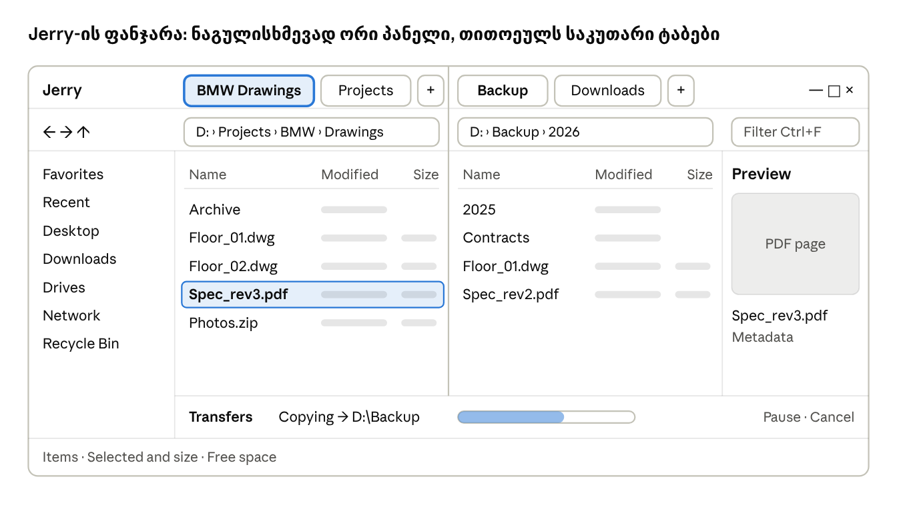

# Jerry — PRD

ფუნქციური მოთხოვნები · Oct 31, 2026 · @Tengo

> წყარო: [Claude Doc](https://claude.ai/artifact/1bMg3DzVQ3FY2P8prF6Si7). ეს ფაილი მისი ასლია (ექსპორტი 03.11.2026).

## მიმოხილვა

Jerry არის საჯარო, ყველასთვის ხელმისაწვდომი ფაილ მენეჯერი Windows-ისთვის, ინგლისურენოვანი ინტერფეისით. ის ყოველდღიურ ფაილურ სამუშაოს (ნავიგაცია, კოპირება, ძებნა, გადარქმევა, წაშლა) Explorer-ზე სწრაფად და ნაკლები კლიკით ასრულებს.

**პრობლემა.** Windows Explorer-ში ღრმა საქაღალდეებში სიარული დამღლელია:

- ყოველი გადასვლა რამდენიმე კლიკს მოითხოვს, სწრაფი გადასვლის საშუალება კი თითქმის არ არსებობს
- ტაბების მართვა სუსტია, ორ საქაღალდეს შორის მუშაობა მოუხერხებელია
- ძებნა ნელია და შედეგები გვიან ჩნდება
- კოპირების ფანჯრები ერთმანეთს ფარავს, კონფლიქტების მართვა გაუგებარია
- კლავიატურით სრულად მართვა შეუძლებელია

**ხედვა.** Jerry ნამდვილ Windows ფაილებზე მუშაობს და Explorer-ს არ ანაცვლებს. ის არის მეორე, უფრო სწრაფი ინსტრუმენტი იმავე ფაილებისთვის. ყველა ცვლილება Explorer-შიც მაშინვე ჩანს და პირიქით.

**სახელი.** Jerry მოდის Tom & Jerry-ის თაგვიდან, რომელიც ყველგან შეძვრება. სახელი მხოლოდ შთაგონებაა. ლოგოსა და აიკონში ორიგინალი პერსონაჟის გამოსახულება არ გამოიყენება, რადგან ის საავტორო უფლებით და სავაჭრო ნიშნით არის დაცული. Jerry-ს აქვს საკუთარი, ორიგინალური თაგვის აიკონი. Jerry საჯარო იქნება, ამიტომ გამოშვებამდე სახელი და აიკონი სავაჭრო ნიშანზე მოწმდება.

**მიზნები:**

1. ნებისმიერ საქაღალდეში მისვლა რამდენიმე წამში, კლავიატურით ან ერთი-ორი კლიკით
2. რამდენიმე საქაღალდეში ერთდროული მუშაობა ტაბებით და ორპანელიანი რეჟიმით
3. ფაილური ოპერაციები, რომლებიც ინტერფეისს არასოდეს აჩერებს
4. სწრაფი ძებნა საქაღალდეებში ფილტრებით
5. უსაფრთხოება: არაფერი იკარგება შემთხვევით (Recycle Bin, Undo)

## მომხმარებელი და ძირითადი სცენარები

ძირითადი მომხმარებელი აქტიური პროფესიონალია. ის დღეში ათობით პროექტულ საქაღალდესთან მუშაობს (ნახაზები, PDF, Excel, არქივები), ხშირად OneDrive-ზე და ქსელურ დისკებზე. უპირატესობას ანიჭებს კლავიატურას, თუმცა მაუსიც აქტიურად სჭირდება.

**ძირითადი სცენარები:**

1. ვხსნი Jerry-ს და წინა სესიის ტაბები ისე მხვდება, როგორც დავტოვე.
2. ვწერ საქაღალდის სახელის ნაწილს და მყისიერად გადავდივარ ფავორიტებსა და ბოლოს გახსნილ საქაღალდეებს შორის.
3. ორ პანელში ერთდროულად ვხსნი წყაროსა და დანიშნულების საქაღალდეს და ერთი ღილაკით ვაკოპირებ.
4. ფაილებს დესკტოპიდან ან Explorer-იდან ვათრევ Jerry-ში და პირიქით: Jerry-იდან Outlook-ში, ბრაუზერში, Telegram-ში.
5. დიდი საქაღალდის კოპირებას ვიწყებ და პარალელურად ვაგრძელებ მუშაობას. პროგრესს ცალკე პანელში ვხედავ.
6. პროექტის საქაღალდეში ვეძებ "\*.dwg" ფაილებს, რომლებიც ამ კვირაში შეიცვალა, და შედეგებს პირდაპირ ვაკოპირებ.
7. 30 ფაილს ერთად ვარქმევ სახელს წესით (მაგ. პრეფიქსი და ნუმერაცია) და გამოყენებამდე ვხედავ შედეგს.
8. შემთხვევით ვშლი ან გადავიტან ფაილს და Ctrl+Z-ით ვაბრუნებ.
9. Space-ით ვხედავ PDF-ის ან სურათის preview-ს გახსნის გარეშე.
10. საქაღალდის მთლიან მისამართს ერთი ბრძანებით ვაკოპირებ, რომ კოლეგას გავუგზავნო.

## პრინციპები და წარმატების კრიტერიუმები

Jerry-ს ხუთი პრინციპი აქვს. ყოველი ახალი ფუნქცია მათით ფასდება.

1. **სიჩქარე პირველ ადგილზე.** ინტერფეისი არასოდეს იყინება. გრძელი ოპერაციები ფონზე მიდის.
2. **კლავიატურა და მაუსი თანაბრად.** ყველა მოქმედება ხელმისაწვდომია shortcut-ით და მაუსითაც.
3. **არაფერი იკარგება.** წაშლა ნაგულისხმევად Recycle Bin-ში მიდის, ცვლილებები Undo-ით ბრუნდება.
4. **მინიმალიზმი.** მხოლოდ ფაილებთან მუშაობის გამარტივება, ზედმეტი ფუნქციების გარეშე.
5. **Windows-ის ჩვევების პატივისცემა.** ცნობილი shortcut-ები და ქცევა (Ctrl+C/V, F2, Del) Explorer-ის მსგავსად მუშაობს.

| კრიტერიუმი | სამიზნე |
| --- | --- |
| აპის გახსნა, პირველ ფანჯრამდე | 1 წამზე ნაკლები |
| 1 000 ელემენტიანი საქაღალდის გამოჩენა | 0.2 წამზე ნაკლები |
| 10 000+ ელემენტიან სიაში scroll | შეფერხების გარეშე |
| ძებნის პირველი შედეგები (50 000 ფაილიანი საქაღალდე) | 1 წამზე ნაკლები |
| ხშირი მოქმედება (კოპირება, გადარქმევა, გადასვლა) | 1 shortcut ან მაქსიმუმ 2 კლიკი |
| ინტერფეისის გაყინვა ფაილური ოპერაციის დროს | არასოდეს |
| მონაცემების დაკარგვა Jerry-ს შეცდომით | ნული |

## ინტერფეისის სტრუქტურა

Jerry-ის ფანჯარა შვიდი ზონისგან შედგება: ზემოთ ნავიგაცია, შუაში მუშაობა, ქვემოთ სტატუსი. ყველა ზონის ზომა drag-ით იცვლება და Jerry მას იმახსოვრებს.

ვიზუალური დიზაინი (ზომები, ფერები, მდგომარეობები): [Jerry — Main Window](https://claude.ai/artifact/SyhnbNFneF1wHCtgTWaB76). ქცევისა და shortcut-ების წყარო ეს დოკუმენტია.

1. **ტაბების ზოლი:** ფანჯრის სათაურის ზოლშივეა, Chrome-ის მსგავსად. ორპანელიან რეჟიმში ზოლი პანელების საზღვარზე ორად იყოფა და თითოეული პანელის ტაბები მის ზემოთაა. მარჯვნივ Windows-ის ღილაკებია (minimize, maximize, close).
2. **Toolbar:** Back/Forward/Up, მისამართის ზოლი (breadcrumbs), სწრაფი ფილტრი, ხედის გადამრთველი, Command palette-ის ღილაკი. ორპანელიან რეჟიმში თითოეულ პანელს საკუთარი მისამართის ზოლი აქვს, ღილაკები კი აქტიურ პანელზე მოქმედებს.
3. **Sidebar:** ფავორიტები, ბოლო საქაღალდეები, დისკები. იმალება Ctrl+B-ით.
4. **ფაილების სია:** მთავარი სამუშაო არე. ნაგულისხმევად ორ პანელად იყოფა, თითოეულს საკუთარი ტაბებით. F3 ერთ პანელზე გადართავს.
5. **Preview პანელი:** მონიშნული ფაილის preview. ჩართვა/გამორთვა Alt+P-ით.
6. **ტრანსფერების პანელი:** ჩნდება მხოლოდ მიმდინარე კოპირების ან გადატანის დროს.
7. **Status bar:** ელემენტების რაოდენობა, მონიშნულის ზომა, დისკზე თავისუფალი ადგილი.

**ზედა ფენები (overlays):** Command palette და Go to folder ფანჯრის ზემოთ, ცენტრში ჩნდება. ასევე Quick Look, კონფლიქტების ფანჯარა, ჯგუფური გადარქმევა და Properties. მოკლე შეტყობინებები (toast) ქვედა მარჯვენა კუთხეში ჩნდება, მაგ. "Copied 12 files · Undo".

**ზომები:** ფანჯრის მინიმალური ზომა 800 × 500. ვიწრო ფანჯარაში preview და sidebar ავტომატურად იმალება.

## ნავიგაცია და ტაბები

ნავიგაცია Jerry-ს მთავარი ფუნქციაა: ნებისმიერ საქაღალდეში მისვლა უნდა მოხდეს ერთი shortcut-ით ან რამდენიმე სიმბოლოს აკრეფით.

**მისამართის ზოლი (breadcrumbs)**

- გზა ნაჩვენებია სეგმენტებად (`D: › Projects › BMW › Drawings`). სეგმენტზე დაჭერა იმ საქაღალდეში გადაგიყვანს.
- სეგმენტის გვერდით ისარი ჩამოშლის მისი ქვესაქაღალდეების სიას სწრაფი გადასვლისთვის.
- ზოლზე დაჭერა ან Ctrl+L რთავს ტექსტურ რეჟიმს. აქ შეიძლება მისამართის ჩაწერა ან ჩასმა, autocomplete-ით.
- მხარდაჭერილია სისტემური ცვლადები და მოკლე სახელები (`%APPDATA%`, `Downloads`, `Desktop`).
- ფაილის მისამართის ჩასმისას Jerry ხსნის მის საქაღალდეს და ამ ფაილს მონიშნავს.

**მოძრაობა**

- Back / Forward / Up ღილაკები და shortcut-ები (Alt+←, Alt+→, Alt+↑, Backspace).
- Back/Forward ღილაკზე მარჯვენა კლიკი აჩვენებს ტაბის ისტორიის სიას.
- Enter ან ორმაგი კლიკი საქაღალდეს ხსნის, ფაილს კი ნაგულისხმევ პროგრამაში ხსნის.
- **Type-to-select:** სიაში სახელის პირველი ასოების აკრეფა მონიშნავს შესაბამის ელემენტს.
- **Go to folder (Ctrl+P):** fuzzy ძებნა ფავორიტებში, ბოლოს გახსნილ საქაღალდეებსა და ღია ტაბებში. Enter გადაგიყვანს, Ctrl+Enter ახალ ტაბში გახსნის.
- განახლება Ctrl+R-ით (F5 ორპანელიან რეჟიმში კოპირებას ეკუთვნის). ცვლილებები ავტომატურადაც ჩანს (იხ. "ფაილების ჩვენება").

**ტაბები**

- ახალი ტაბი (Ctrl+T), დახურვა (Ctrl+W), ბოლოს დახურულის აღდგენა (Ctrl+Shift+T), ტაბებს შორის გადართვა (Ctrl+Tab, Ctrl+1…9).
- საქაღალდეზე შუა ღილაკით დაჭერა ან Ctrl+Enter მას ახალ ტაბში ხსნის.
- ყველა ტაბს აქვს საკუთარი ისტორია, მონიშვნა, ხედი და დალაგება.
- ტაბების გადაადგილება drag-ით და ტაბის ცალკე ფანჯრად გამოტანა.
- **Pin:** მიმაგრებული ტაბი ვიწროა, ყოველთვის მარცხნივ დგას და შემთხვევით არ იხურება.
- ტაბის context menu: Duplicate, Pin, Close others, Close to the right, Copy path.
- ტაბზე ჩანს საქაღალდის სახელი, სრული მისამართი კი tooltip-ში.
- **სესიის აღდგენა:** Jerry-ს ხელახლა გახსნისას ყველა ტაბი და ფანჯარა ბრუნდება (გამორთვა შესაძლებელია პარამეტრებში).

**ორპანელიანი რეჟიმი (Dual-pane)**

- ნაგულისხმევად მთავარი არე ორ დამოუკიდებელ პანელად არის გაყოფილი, თითოეულს საკუთარი ტაბებით. F3 ან ღილაკი ერთ პანელზე გადართავს და უკან.
- Tab კლავიშით აქტიური პანელი იცვლება.
- F5 აკოპირებს მონიშნულს მეორე პანელის საქაღალდეში, F6 გადაიტანს. ორივე დადასტურების ფანჯრით.
- "Same folder in other pane" ბრძანება მეორე პანელში იმავე საქაღალდეს ხსნის.
- **Compare panes (Ctrl+F9):** ორივე პანელში აჩენს უფრო ახალ და მეორე პანელში არარსებულ ფაილებს და შეუძლია მათი მონიშვნა. კოპირება ჩვეულებრივ F5-ით ხდება: Jerry თავად არაფერს აკოპირებს და არ ასინქრონებს.

**რამდენიმე ფანჯარა:** Ctrl+N ხსნის ახალ ფანჯარას. ფანჯრებს შორის ტაბებისა და ფაილების გადატანა drag-ით შეიძლება.

## ფაილების ჩვენება და მონიშვნა

სია ყოველთვის ცოცხალია: გარედან შექმნილი, წაშლილი ან შეცვლილი ფაილი Jerry-ში ავტომატურად ჩანს, განახლების გარეშე.

**ხედები**

- **Details** (ნაგულისხმევი): სვეტებად სახელი, შეცვლის თარიღი, ტიპი, ზომა. შექმნის თარიღი და გაფართოება სურვილისამებრ ემატება.
- **List:** კომპაქტური სია, მხოლოდ აიკონი და სახელი.
- **Grid:** დიდი აიკონები და thumbnail-ები სურათებისა და PDF-ისთვის.
- ხედის შეცვლა: Ctrl+Shift+1/2/3 ან ღილაკი toolbar-ზე.
- Jerry იმახსოვრებს ხედსა და დალაგებას ყოველი საქაღალდისთვის (გამორთვა შესაძლებელია).

**დალაგება და სვეტები**

- სვეტის სათაურზე დაჭერა ალაგებს ზრდადობით, მეორე დაჭერა კლებადობით.
- საქაღალდეები ყოველთვის ფაილებზე წინ დგას (პარამეტრებში იცვლება).
- **ბუნებრივი დალაგება:** `file2` დგას `file10`-მდე.
- სვეტების სიგანის შეცვლა, გადაადგილება და დამალვა სათაურის context menu-დან.
- საქაღალდის ზომა ნაგულისხმევად არ ითვლება. ის მოთხოვნით ითვლება (Calculate size), ფონზე.

**ჩვენების წესები**

- ფარული და სისტემური ფაილების ჩვენება/დამალვა: Ctrl+H.
- გაფართოებები ყოველთვის ჩანს (პარამეტრებში იცვლება).
- ფაილის აიკონები Windows-ისაა, რომ ფაილის ტიპი Explorer-ის მსგავსად ამოიცნობოდეს.
- OneDrive-ის ფაილებს აქვს სინქრონიზაციის ნიშანი: მხოლოდ cloud-ში, ხელმისაწვდომი offline, სინქრონიზდება.
- ცარიელ საქაღალდეში ჩანს მინიშნება ("This folder is empty. Drop files here").
- ნელ დისკზე (ქსელური, USB) ჩატვირთვის ინდიკატორი ჩანს და ინტერფეისი არ იყინება.

**Status bar**

ქვედა ზოლი აჩვენებს: ელემენტების რაოდენობას, მონიშნულის რაოდენობასა და ჯამურ ზომას, დისკზე თავისუფალ ადგილს.

**მონიშვნა**

- კლიკი, Ctrl+კლიკი (დამატება), Shift+კლიკი (დიაპაზონი), Ctrl+A (ყველა).
- მართკუთხედით მონიშვნა მაუსით, ცარიელი ადგილიდან.
- Shift+ისრები დიაპაზონისთვის, Ctrl+Space ცალკეული ელემენტის მონიშვნა/მოხსნისთვის.
- **Invert selection** (Ctrl+I).
- **Select by pattern** (Ctrl+Shift+A): მაგ. `*.pdf` ან `*_rev*` მონიშნავს ყველა შესაბამისს.
- Esc მოხსნის მონიშვნას.

## ფაილური ოპერაციები (CRUD)

ყველა ოპერაცია ხელმისაწვდომია shortcut-ით, context menu-დან და toolbar-იდან. ყველა ოპერაცია Undo-ით ბრუნდება, გარდა სამუდამო წაშლისა.

**შექმნა (Create)**

- **ახალი საქაღალდე** (Ctrl+Shift+N): ჩნდება სიაში, სახელის ველი მაშინვე აქტიურია.
- **ახალი ფაილი** (Ctrl+Alt+N): ცარიელი ფაილი არჩეული ტიპით (.txt, .md, .docx, .xlsx), ან ნებისმიერი გაფართოებით.
- **Duplicate** (Ctrl+D): ქმნის ასლს იმავე საქაღალდეში, სახელით `name (copy)`.
- **ZIP არქივის შექმნა:** მონიშნულიდან. სახელი ავტომატურად შემოთავაზებულია.

**ნახვა და ინფორმაცია (Read)**

- ფაილის გახსნა ნაგულისხმევ პროგრამაში, ან **Open with** სხვა პროგრამის არჩევით.
- **Properties** (Alt+Enter): ზომა, ფაილების რაოდენობა საქაღალდეში, შექმნისა და შეცვლის თარიღები, სრული მისამართი, ატრიბუტები.
- **Copy path** (Ctrl+Shift+C) აკოპირებს სრულ მისამართს. **Copy name** (Ctrl+Alt+C) აკოპირებს მხოლოდ სახელს. რამდენიმე მონიშნულის შემთხვევაში თითოეული ახალ ხაზზეა.
- **ZIP-ის ამოღება:** "Extract here" ან "Extract to folder". ZIP-ის შიგნით ნავიგაცია, როგორც ჩვეულებრივ საქაღალდეში (მხოლოდ წასაკითხად).

**ცვლილება (Update)**

- **გადარქმევა** (F2 ან ნელი ორმაგი კლიკი): პირდაპირ სიაში. ნაგულისხმევად მოინიშნება მხოლოდ სახელი, გაფართოების გარეშე.
- გაფართოების შეცვლისას Jerry დადასტურებას ითხოვს.
- Enter ინახავს, Esc აუქმებს. Tab გადადის შემდეგი ფაილის გადარქმევაზე.
- არასწორი სიმბოლოები (`\ / : * ? " < > |`) და Windows-ის დაცული სახელები (CON, NUL და ა.შ.) ბლოკირდება, მინიშნებით, ჯერ კიდევ აკრეფისას.
- **ჯგუფური გადარქმევა (Batch rename):** რამდენიმე მონიშნულზე F2 ხსნის ფანჯარას:
  - ტექსტის ძებნა და ჩანაცვლება
  - პრეფიქსი/სუფიქსი
  - ნუმერაცია (საწყისი რიცხვი, ნაბიჯი, ციფრების რაოდენობა: 001, 002…)
  - რეგისტრის შეცვლა (UPPER, lower, Title)
  - გაფართოების შეცვლა
  - **ცხრილი "Before → After"** გამოყენებამდე, კონფლიქტების მონიშვნით
- **ატრიბუტები:** Read-only და Hidden ჩართვა/გამორთვა Properties-დან.

**წაშლა (Delete)**

- **Del** აგზავნის Recycle Bin-ში. დადასტურება ნაგულისხმევად გამორთულია, რადგან ყველაფერი Undo-ით ბრუნდება.
- **Shift+Del** შლის სამუდამოდ. ყოველთვის ითხოვს დადასტურებას, ფაილების რაოდენობისა და ჯამური ზომის ჩვენებით.
- 100-ზე მეტი ელემენტის ან სისტემური საქაღალდის წაშლისას Jerry ყოველთვის ითხოვს დადასტურებას.
- ქსელურ დისკზე, სადაც Recycle Bin არ არსებობს, Jerry წინასწარ აფრთხილებს, რომ წაშლა სამუდამო იქნება.

## კოპირება, გადატანა და ტრანსფერების რიგი

ყველა კოპირება და გადატანა ფონზე მიდის. სანამ ის მიმდინარეობს, მომხმარებელი Jerry-ში მუშაობას თავისუფლად აგრძელებს.

**Clipboard**

- Ctrl+C (კოპირება), Ctrl+X (ამოჭრა), Ctrl+V (ჩასმა მიმდინარე ან მონიშნულ საქაღალდეში).
- ამოჭრილი ფაილები სიაში ნახევრად გამჭვირვალედ ჩანს, ჩასმამდე.
- **Explorer-თან თავსებადობა:** Explorer-ში დაკოპირებული ფაილი Jerry-ში ჩაისმება და პირიქით. Jerry-იდან დაკოპირებული ფაილი Outlook-სა და Telegram-შიც ჩაისმება.
- **Paste as:** ტექსტის ან სურათის ჩასმა clipboard-იდან ახალ ფაილად (მაგ. screenshot ჩასმისას იქმნება `.png`).
- **Copy to / Move to:** ფანჯარა დანიშნულების ასარჩევად (Shift+F5 / Shift+F6). ზემოთ ფავორიტები და ბოლო საქაღალდეებია.

**ტრანსფერების პანელი**

- ჩნდება ქვემოთ, როცა ოპერაცია 1 წამზე მეტხანს გრძელდება. დახურვის შემდეგ ოპერაცია გრძელდება, status bar-ში კი ინდიკატორი ჩანს.
- ყოველ ოპერაციაზე ჩანს: წყარო → დანიშნულება, პროცენტი, სიჩქარე (MB/s), დარჩენილი დრო, მიმდინარე ფაილი, ფაილები N / სულ.
- მართვა: **Pause / Resume / Cancel** თითოეულზე და ყველაზე ერთად.
- **რიგი:** ერთ დისკზე ოპერაციები ერთმანეთის მიყოლებით სრულდება, სხვადასხვა დისკზე პარალელურად. რიგის თანმიმდევრობა drag-ით იცვლება.
- დასრულებისას Windows-ის შეტყობინება ჩნდება, თუ Jerry ფოკუსში არ არის. დაჭერა დანიშნულების საქაღალდეს ხსნის.
- გაუქმებისას Jerry ნახევრად კოპირებულ ფაილს შლის, უკვე დასრულებულს კი ტოვებს.

**კონფლიქტები (ფაილი უკვე არსებობს)**

- ფანჯარა ორივე ფაილის შედარებით: ზომა, შეცვლის თარიღი, thumbnail. უფრო ახალი ფაილი გამოკვეთილია.
- არჩევანი: **Replace**, **Skip**, **Keep both** (`name (2).ext`), **Replace if newer**.
- "Apply to all" ერთი კლიკით ავრცელებს არჩევანს ყველა შემდეგ კონფლიქტზე.
- საქაღალდის კონფლიქტისას: **Merge** (შიგთავსის გაერთიანება) ან **Keep both**.
- სანამ პასუხს ელოდება, კონფლიქტი მხოლოდ თავის ოპერაციას აჩერებს და არა მთელ რიგს.

**ქცევის წესები**

- იმავე დისკზე გადატანა მყისიერია, რადგან ფაილი ფიზიკურად არ კოპირდება.
- სხვა დისკზე გადატანა: ჯერ კოპირება, წაშლა წყაროდან მხოლოდ წარმატებული კოპირების შემდეგ.
- ოპერაციის დაწყებამდე Jerry ამოწმებს ადგილს დანიშნულებაზე. თუ ადგილი არ კმარა, აფრთხილებს და დაწყებას არ იწყებს.
- ცალკეული ფაილის შეცდომა მთელ ოპერაციას არ აჩერებს. ბოლოს ჩანს შეჯამება: "3 files could not be copied", სიით და Retry ღილაკით.
- ფაილის საკუთარ თავში ან ქვესაქაღალდეში კოპირება/გადატანა ბლოკირდება, განმარტებით.

## Drag & Drop

Drag & drop ორივე მიმართულებით მუშაობს: Jerry-ის შიგნით, Windows-იდან Jerry-ში და Jerry-იდან ნებისმიერ სხვა პროგრამაში.

| საიდან | სად | შედეგი |
| --- | --- | --- |
| Jerry | იმავე სიაში საქაღალდეზე | გადატანა/კოპირება ამ საქაღალდეში |
| Jerry | სხვა ტაბზე (გაჩერება 0.7 წამი) | ტაბი იხსნება, ჩაგდება მის საქაღალდეში |
| Jerry | ტაბების ზოლის ცარიელ ადგილზე | საქაღალდე ახალ ტაბში იხსნება |
| Jerry | მეორე პანელში (dual-pane) | კოპირება/გადატანა მეორე პანელის საქაღალდეში |
| Jerry | breadcrumb-ის სეგმენტზე | ჩაგდება ამ ზედა საქაღალდეში |
| Jerry | sidebar-ის ფავორიტზე ან დისკზე | ჩაგდება ამ ადგილას |
| Jerry | sidebar-ის ფავორიტების ზონაში (საქაღალდე) | საქაღალდე ფავორიტებში ემატება |
| დესკტოპი / Explorer | Jerry-ის სიაში ან საქაღალდეზე | ფაილები ემატება ამ საქაღალდეში |
| ბრაუზერი / Outlook (attachment) | Jerry-ის სიაში | ფაილი ინახება ამ საქაღალდეში (თუ წყარო ამას იძლევა) |
| Jerry | დესკტოპზე / Explorer-ში | ფაილი კოპირდება ან გადადის იქ |
| Jerry | სხვა პროგრამაში (Outlook, ბრაუზერი, Telegram, AutoCAD) | ფაილი მიმაგრდება, აიტვირთება ან გაიხსნება, როგორც Explorer-იდან |

**კოპირება თუ გადატანა**

- ნაგულისხმევი წესი Windows-ისაა: იმავე დისკზე გადატანა, სხვა დისკზე კოპირება.
- **Ctrl** აიძულებს კოპირებას, **Shift** გადატანას, **Alt** shortcut-ის შექმნას.
- **მარჯვენა ღილაკით გადათრევა** ჩაგდებისას აჩვენებს მენიუს: Copy here, Move here, Cancel.

**ვიზუალური უკუკავშირი**

- კურსორთან ჩანს ბეჯი: მოქმედება და ელემენტების რაოდენობა ("Move 5 items to Drawings").
- სამიზნე საქაღალდე ან ტაბი გამოკვეთილია. დაუშვებელ ადგილას კურსორი "აკრძალულ" ნიშანს აჩვენებს.
- **Spring-loaded folders:** საქაღალდეზე 0.7 წამი გაჩერებისას ის იხსნება, და შეიძლება უფრო ღრმად ჩასვლა ჩაგდებამდე.
- სიის კიდესთან მიტანისას სია ავტომატურად scroll-დება.
- Esc აუქმებს გადათრევას.

**წესები**

- ჩაგდების შემდეგ ოპერაცია ჩვეულებრივ ტრანსფერების რიგში ხვდება, კონფლიქტების ფანჯრით და Undo-ით.
- ფაილის საკუთარ თავზე ან ქვესაქაღალდეზე ჩაგდება დაუშვებელია.

## ძებნა და ფილტრი

Jerry-ს ორი დონე აქვს: მყისიერი ფილტრი მიმდინარე საქაღალდეში და ღრმა ძებნა ქვესაქაღალდეებში.

**სწრაფი ფილტრი (Ctrl+F)**

- ფილტრის ველი toolbar-შია. აკრეფისთანავე სია მხოლოდ შესაბამის ელემენტებს აჩვენებს.
- მუშაობს ნაწილობრივ დამთხვევაზე და wildcard-ებზე (`*.pdf`, `rev*`).
- ფილტრი მოქმედებს მხოლოდ მიმდინარე ტაბში. Esc ასუფთავებს.
- აქტიური ფილტრი ნათლად ჩანს ("Showing 12 of 340"), რომ ფაილები "დაკარგული" არ ეგონოს.

**ღრმა ძებნა (Ctrl+Shift+F)**

- ძებნის ზონა: მიმდინარე საქაღალდე და მისი ყველა ქვესაქაღალდე. სურვილისამებრ მთელი დისკი.
- ძებნა სახელით: ნაწილობრივი დამთხვევა, wildcard-ები, რამდენიმე სიტყვა (ყველა უნდა ემთხვეოდეს).
- **ფილტრები:**
  - ტიპი: დოკუმენტები, ნახაზები (DWG/DXF), სურათები, არქივები, ვიდეო, ან კონკრეტული გაფართოება
  - ზომა: მეტი/ნაკლები ვიდრე, ან მზა დიაპაზონები
  - შეცვლის თარიღი: დღეს, ამ კვირაში, ამ თვეში, თარიღების დიაპაზონი
  - მხოლოდ ფაილები / მხოლოდ საქაღალდეები
- შედეგები ჩნდება პოვნისთანავე, ძებნის დასრულებას არ ელოდება. ჩანს მიმდინარე სტატუსი ("Found 48, searching…") და Stop ღილაკი.
- შედეგები იხსნება ცალკე ტაბში, "Location" სვეტით.
- შედეგებზე ყველა ჩვეულებრივი ოპერაცია მუშაობს: გახსნა, კოპირება, გადატანა, წაშლა, drag & drop, preview.
- **Open containing folder** (Ctrl+Shift+E) ფაილის საქაღალდეს ახალ ტაბში ხსნის და ფაილს მონიშნავს.
- ბოლო 20 ძებნა ინახება და ძებნის ველში ჩამოშლად სიაში ჩანს.

**შეზღუდვები**

- ძებნა OneDrive-ის მხოლოდ cloud-ში არსებულ ფაილებს არ ჩამოტვირთავს. ის მხოლოდ სახელებსა და მეტამონაცემებს კითხულობს.
- სისტემური საქაღალდეები (Windows, Program Files) ნაგულისხმევად გამორიცხულია, სანამ მომხმარებელი პირდაპირ არ აირჩევს.
- ფაილების შიგთავსში ძებნა 1.0 ვერსიის შემდეგ ემატება (იხ. "პრიორიტეტები").

## Preview და ფაილის გახსნა

ფაილის შიგთავსი ჩანს მისი გახსნის გარეშე: Space-ით სწრაფ ფანჯარაში ან მუდმივ preview პანელში.

**Quick Look (Space)**

- Space ხსნის preview-ს ფანჯრის ცენტრში. მეორე Space ან Esc ხურავს.
- ღია preview-ში ისრები გადადის შემდეგ/წინა ფაილზე.
- ზემოთ ჩანს სახელი და ღილაკები: Open, Open with, Copy path.

**Preview პანელი (Alt+P)**

- მარჯვენა მხარეს, ჩართვა/გამორთვა. სიგანე იცვლება drag-ით.
- მონიშნულის შეცვლისას preview ავტომატურად განახლდება.
- ქვემოთ ჩანს მეტამონაცემები: ზომა, თარიღები, სურათის გარჩევადობა, PDF-ის გვერდების რაოდენობა, დოკუმენტის სათაური და ავტორი, ფაილის Windows Tags თვისება (მხოლოდ წასაკითხად, როგორც Explorer-ში).

**მხარდაჭერილი ტიპები**

| ტიპი | რას აჩვენებს |
| --- | --- |
| სურათები (JPG, PNG, GIF, WEBP, SVG, BMP) | სურათი, zoom-ით |
| PDF | გვერდები, scroll-ით |
| ტექსტი და კოდი (TXT, MD, JSON, CSV, LOG, კოდის ფაილები) | შიგთავსი, Markdown გაფორმებით |
| ვიდეო და აუდიო (MP4, MP3, WAV) | Player, play/pause |
| საქაღალდე | შიგთავსის სია და ჯამური ზომა |
| ZIP | შიგთავსის სია |
| სხვა (DWG, DOCX, XLSX და ა.შ.) | Windows-ის thumbnail, თუ არსებობს, და მეტამონაცემები |

**გახსნა**

- Enter ან ორმაგი კლიკი ხსნის ნაგულისხმევ პროგრამაში.
- **Open with:** Windows-ის პროგრამების სია. ზემოთ ის პროგრამებია, რომლებითაც ეს ტიპი ბოლოს გაიხსნა.
- **Open in Terminal:** მიმდინარე საქაღალდეში ხსნის Windows Terminal-ს ან PowerShell-ს.
- **Show in Explorer:** იმავე საქაღალდეს Explorer-ში ხსნის, ფაილის მონიშვნით.
- **ჩემი პროგრამები:** პარამეტრებში მომხმარებელს შეუძლია დაამატოს "Open in…" ბრძანებები (მაგ. VS Code, AutoCAD), რომლებიც context menu-ში გამოჩნდება.

## Sidebar, ფავორიტები და დისკები

Sidebar მარცხნივ დგას და ხშირად გამოყენებულ ადგილებს ერთ კლიკზე აჩერებს. Ctrl+B მას მალავს ან აჩენს.

**სექციები (ზემოდან ქვემოთ)**

1. **ფავორიტები:** მომხმარებლის მიერ მიმაგრებული საქაღალდეები.
2. **ბოლო საქაღალდეები:** 10 ბოლოს გახსნილი, ავტომატურად.
3. **სტანდარტული:** Desktop, Downloads, Documents, Pictures, OneDrive.
4. **დისკები:** ყველა დისკი, თავისუფალი ადგილის ზოლით. 90%-ზე მეტად სავსე დისკი წითლად ჩანს.
5. **ქსელი:** mapped network drive-ები და ხელით დამატებული ქსელური მისამართები (`\\server\share`).
6. **Recycle Bin.**

**ფავორიტები**

- საქაღალდის დამატება: drag sidebar-ში, context menu-დან "Add to favorites", ან Ctrl+Shift+D.
- სახელის შეცვლა ფავორიტისთვის (მაგ. `D:\Projects\2026\BMW\Drawings` → "BMW ნახაზები"). ორიგინალი საქაღალდე არ იცვლება.
- თანმიმდევრობის შეცვლა drag-ით. სექციებად დაჯგუფება (მაგ. "Insta", "TSGroup", "პირადი").
- თუ ფავორიტის საქაღალდე წაიშალა ან დისკი გაითიშა, ის ნაცრისფრად ჩანს და დაჭერისას Jerry ამას განმარტავს.

**დისკები**

- USB ან სხვა მოსახსნელი დისკი ავტომატურად ჩნდება და ქრება. მის გვერდით არის **Eject** ღილაკი.
- თუ მოსახსნელი დისკზე ტრანსფერი მიმდინარეობს, Eject აფრთხილებს.

**Recycle Bin**

- Jerry-ში ჩანს წაშლილი ფაილები: ორიგინალი მისამართით და წაშლის თარიღით.
- **Restore** აბრუნებს ორიგინალ ადგილას. **Empty Recycle Bin** დადასტურებით.

## კლავიატურა, command palette და context menu

Jerry-ში ყველა მოქმედება ხელმისაწვდომია კლავიატურით. Windows-ის ცნობილი shortcut-ები Explorer-ის მსგავსად მუშაობს.

**Command palette (Ctrl+Shift+P)**

- ფანჯარა ყველა ბრძანების fuzzy ძებნით ("new folder", "copy path", "dual pane", "hidden").
- ყოველი ბრძანების გვერდით მისი shortcut ჩანს, რომ მომხმარებელმა ისწავლოს.
- ზემოთ ბოლოს გამოყენებული ბრძანებებია.
- პრეფიქსები: `>` ბრძანებები (ნაგულისხმევი), `@` საქაღალდეები (როგორც Go to folder). Tab რეჟიმს ცვლის.

**ძირითადი shortcut-ები**

| ჯგუფი | მოქმედება | Shortcut |
| --- | --- | --- |
| ნავიგაცია | მისამართის ზოლი | Ctrl+L |
| ნავიგაცია | Back / Forward / Up | Alt+← / Alt+→ / Alt+↑ (ან Backspace) |
| ნავიგაცია | Go to folder | Ctrl+P |
| ნავიგაცია | განახლება | Ctrl+R |
| ტაბები | ახალი / დახურვა / აღდგენა | Ctrl+T / Ctrl+W / Ctrl+Shift+T |
| ტაბები | შემდეგი ტაბი / ტაბი N | Ctrl+Tab / Ctrl+1…9 |
| ფანჯრები | ახალი ფანჯარა | Ctrl+N |
| ფანჯრები | ორპანელიანი რეჟიმი / პანელის შეცვლა | F3 / Tab |
| ფანჯრები | კოპირება / გადატანა მეორე პანელში | F5 / F6 |
| ფანჯრები | Copy to… / Move to… | Shift+F5 / Shift+F6 |
| ფანჯრები | პანელების შედარება | Ctrl+F9 |
| ხედი | Details / List / Grid | Ctrl+Shift+1 / 2 / 3 |
| ხედი | ფარული ფაილები | Ctrl+H |
| ხედი | Sidebar / Preview პანელი | Ctrl+B / Alt+P |
| ხედი | სიმჭიდროვე: Compact / Comfortable | Ctrl+Alt+D |
| მონიშვნა | ყველა / შებრუნება / შაბლონით | Ctrl+A / Ctrl+I / Ctrl+Shift+A |
| ფაილები | ახალი საქაღალდე / ახალი ფაილი | Ctrl+Shift+N / Ctrl+Alt+N |
| ფაილები | გადარქმევა | F2 |
| ფაილები | Duplicate | Ctrl+D |
| ფაილები | Recycle Bin / სამუდამო წაშლა | Del / Shift+Del |
| ფაილები | Properties | Alt+Enter |
| ფაილები | მისამართის / სახელის კოპირება | Ctrl+Shift+C / Ctrl+Alt+C |
| Clipboard | კოპირება / ამოჭრა / ჩასმა | Ctrl+C / Ctrl+X / Ctrl+V |
| ძებნა | ფილტრი / ღრმა ძებნა | Ctrl+F / Ctrl+Shift+F |
| ძებნა | ფაილის საქაღალდის გახსნა | Ctrl+Shift+E |
| Preview | Quick Look | Space |
| ისტორია | Undo / Redo | Ctrl+Z / Ctrl+Y |
| სხვა | ფავორიტებში დამატება | Ctrl+Shift+D |
| სხვა | Command palette / პარამეტრები | Ctrl+Shift+P / Ctrl+, |

- პარამეტრებში ყველა shortcut-ის სია ჩანს და მათი შეცვლა შეიძლება. კონფლიქტისას Jerry აფრთხილებს.
- F1 ან `?` აჩვენებს shortcut-ების მოკლე ცხრილს.

**Context menu (მარჯვენა კლიკი)**

- Jerry-ის საკუთარი მენიუ მოკლე და სწრაფია. ფაილზე: Open, Open with, Quick Look, Cut, Copy, Paste, Rename, Duplicate, Delete, Copy path, Compress to ZIP, Add to favorites, Open in Terminal, Show in Explorer, Properties.
- ცარიელ ადგილზე: New folder, New file, Paste, View, Sort by, Open in Terminal, Refresh.
- ბოლოში **"Windows options…"** ხსნის Windows-ის ორიგინალ მენიუს, სხვა პროგრამების ბრძანებებით (7-Zip, OneDrive, ანტივირუსი).
- მენიუს ყოველ ბრძანებასთან ჩანს მისი shortcut.

## Undo და ოპერაციების ისტორია

Ctrl+Z აბრუნებს ბოლო ფაილურ ოპერაციას, Ctrl+Y კი ხელახლა ასრულებს მას. ეს Jerry-ის "არაფერი იკარგება" პრინციპის საფუძველია.

| ოპერაცია | Undo-ს შედეგი |
| --- | --- |
| გადარქმევა (მათ შორის ჯგუფური) | ძველი სახელები ბრუნდება |
| გადატანა (მათ შორის drag-ით) | ფაილები ბრუნდება წყაროში |
| კოპირება | შექმნილი ასლები Recycle Bin-ში მიდის |
| წაშლა Recycle Bin-ში | ფაილები აღდგება ორიგინალ ადგილას |
| ახალი საქაღალდე/ფაილი | იშლება, თუ ჯერ კიდევ ცარიელია |
| ZIP-ის შექმნა/ამოღება | შექმნილი არქივი ან ამოღებული ფაილები Recycle Bin-ში მიდის |
| სამუდამო წაშლა (Shift+Del) | Undo შეუძლებელია, ამიტომ დადასტურება სავალდებულოა |

- Undo-ს შემდეგ ჩნდება მოკლე შეტყობინება: "Undone: move of 5 files".
- თუ ფაილი ოპერაციის შემდეგ სხვაგან შეიცვალა, Undo ამ ფაილს გამოტოვებს და განმარტავს.
- **ისტორიის პანელი:** ბოლო 50 ოპერაცია სესიის განმავლობაში, დროით, წყაროთი და დანიშნულებით. ნებისმიერი ოპერაციის გაუქმება შეიძლება სიიდან.
- Jerry-ის დახურვისას ისტორია იშლება. Recycle Bin-ის ფაილები Windows-ში რჩება.

## პარამეტრები და პერსონალიზაცია

პარამეტრები (Ctrl+,) ერთ ფანჯარაშია, ძებნით. ცვლილება მაშინვე მოქმედებს, აპის გადატვირთვის გარეშე.

| ჯგუფი | პარამეტრი | ნაგულისხმევი |
| --- | --- | --- |
| გარეგნობა | თემა: Light / Dark / System | System |
| გარეგნობა | Accent ფერი | Windows-ის accent (Match Windows); ან Jerry-ის 6 ფერიდან ერთი |
| გარეგნობა | სიმჭიდროვე: Compact / Comfortable | Comfortable |
| გარეგნობა | შრიფტის ზომა | 100% |
| გარეგნობა | Mica ფონი | ჩართული |
| ფორმატი | თარიღის ფორმატი | DD.MM.YYYY |
| გაშვება | საწყისი ადგილი: წინა სესია / კონკრეტული საქაღალდე | წინა სესია |
| ჩვენება | ფარული ფაილები | გამორთული |
| ჩვენება | გაფართოებების ჩვენება | ჩართული |
| ჩვენება | საქაღალდეები ფაილებზე წინ | ჩართული |
| ჩვენება | ნაგულისხმევი ხედი | Details |
| ჩვენება | ორპანელიანი რეჟიმი | ჩართული |
| ჩვენება | ხედის დამახსოვრება ყოველი საქაღალდისთვის | ჩართული |
| ქცევა | ერთი თუ ორმაგი კლიკი გასახსნელად | ორმაგი |
| ქცევა | Recycle Bin-ში წაშლის დადასტურება | გამორთული |
| ქცევა | Drag-ის ნაგულისხმევი მოქმედება | Windows-ის წესი |
| ქცევა | Spring-loaded folders-ის დაყოვნება | 0.7 წმ |
| ტრანსფერები | პარალელური ოპერაციები სხვადასხვა დისკზე | ჩართული |
| ტრანსფერები | შეტყობინება დასრულებისას | ჩართული |
| კლავიატურა | Shortcut-ების ნახვა და შეცვლა | — |
| პროგრამები | "Open in…" ბრძანებები (VS Code, AutoCAD…) | ცარიელი |
| Windows | გაშვება Windows-თან ერთად / ფონზე დარჩენა / გლობალური hotkey | იხ. შემდეგი სექცია |
| განახლებები | ახალი ვერსიის შემოწმება და შეტყობინება | ჩართული |

- **Reset to defaults** თითოეულ ჯგუფზე და მთლიანად.
- პარამეტრების, ფავორიტებისა და shortcut-ების **Export / Import** ფაილად, ახალ კომპიუტერზე გადასატანად.

## Windows-თან ინტეგრაცია

Jerry Windows-ის ნაწილივით იქცევა: ის ერთი shortcut-ით იხსნება და Explorer-თან ორმხრივად მუშაობს.

- **გლობალური hotkey** (ნაგულისხმევად Ctrl+Alt+J, შეცვლადი): ნებისმიერი პროგრამიდან Jerry-ს წინ გამოიტანს ან გახსნის.
- **ერთი ეგზემპლარი:** თუ Jerry უკვე ღიაა, ახალი გახსნა (მაგ. "Open in Jerry"-დან) ახალ ტაბს ხსნის არსებულ ფანჯარაში.
- **ფონზე დარჩენა** (პარამეტრი "Keep Jerry running in the background", ნაგულისხმევად ჩართული): ბოლო ფანჯრის დახურვა Jerry-ს მალავს და არ თიშავს, ამიტომ შემდეგი გახსნა მყისიერია. სრულად გათიშვა ბრძანებით "Exit Jerry". პარამეტრის გამორთვისას ბოლო ფანჯრის დახურვა Jerry-ს თიშავს. მიზეზი: hybrid GPU-იან ლეპტოპზე ცივი გაშვება ~2 წამია (Tech PRD, spike #1).
- **"Open in Jerry"** Explorer-ის context menu-ში, საქაღალდეზე და საქაღალდის ცარიელ ადგილზე. ჩართვა/გამორთვა პარამეტრებიდან.
- **გაშვება Windows-თან ერთად** (სურვილისამებრ). Jerry ფონზე იხსნება, რომ hotkey-ზე მყისიერად გამოჩნდეს.
- **Jerry როგორც ნაგულისხმევი ფაილ მენეჯერი** (სურვილისამებრ, 1.0-ის შემდეგ): Win+E და საქაღალდეების გახსნა სხვა პროგრამებიდან Jerry-ში. გამორთვა ერთი ღილაკით აბრუნებს Explorer-ს.
- **სისტემური აიკონები და thumbnail-ები:** იგივე, რაც Explorer-ში.
- **OneDrive:** სინქრონიზაციის სტატუსი თითოეულ ფაილზე. context menu-ში "Always keep on this device" და "Free up space".
- **შეტყობინებები** Windows-ის Notification Center-ში (ტრანსფერის დასრულება, შეცდომა).
- **Taskbar:** კოპირების პროგრესი ჩანს Jerry-ის აიკონზე, taskbar-ზე.
- **განახლებები:** Jerry ახალ ვერსიას ამოწმებს გაშვებისას და დღეში ერთხელ, როგორც სხვა აპები. ახალი ვერსიისას ჩნდება შეტყობინება ცვლილებების მოკლე სიით და Update ღილაკით. განახლება მხოლოდ მომხმარებლის თანხმობით იყენება, შემდეგ Jerry თავიდან იხსნება და ტაბები ბრუნდება. შემოწმების გამორთვა პარამეტრებშია.

## შეცდომები, უსაფრთხოება და ზღვრული შემთხვევები

ყველა შეცდომა ადამიანურ ენაზე აიხსნება და ყოველთვის გვთავაზობს შემდეგ ნაბიჯს. Jerry არასოდეს ჩერდება ან იყინება ერთი ფაილის გამო.

| სიტუაცია | Jerry-ის ქცევა |
| --- | --- |
| წვდომა აკრძალულია | "You don't have permission to open this folder". ღილაკები: Show in Explorer, Skip |
| ფაილი სხვა პროგრამაშია გახსნილი | ასახელებს პროგრამას, თუ ცნობილია. ღილაკები: Retry, Skip |
| დისკზე ადგილი არ კმარა | შემოწმება ოპერაციამდე. ჩანს საჭირო და არსებული ადგილი |
| დისკი/ქსელი გაითიშა ტრანსფერისას | ოპერაცია პაუზდება. დაბრუნებისას Resume, ან Cancel |
| გრძელი მისამართი (260+ სიმბოლო) | ჩვეულებრივ მუშაობს, შეზღუდვის გარეშე |
| არასწორი სახელი | ბლოკირება ჯერ კიდევ აკრეფისას, მიზეზის ჩვენებით |
| ნელი ქსელური დისკი | ჩატვირთვის ინდიკატორი. ინტერფეისი და სხვა ტაბები მუშაობს |
| ძალიან დიდი საქაღალდე (100 000+) | სია ეტაპობრივად ივსება, scroll მაშინვე მუშაობს |
| Symlink / junction წრეები | ძებნა და კოპირება წრეში არ შედის |
| სისტემური საქაღალდეები (Windows, Program Files) | წაშლა/გადატანა მხოლოდ დამატებითი დადასტურებით |
| Jerry-ის მოულოდნელი დახურვა ტრანსფერისას | ხელახლა გახსნისას ჩანს, რომელი ოპერაცია არ დასრულდა |

**უსაფრთხოება და კონფიდენციალურობა**

- Jerry სრულად ლოკალურად მუშაობს. ის არ აგზავნის ფაილებს, მისამართებს ან სტატისტიკას ინტერნეტში. ერთადერთი ქსელური მოთხოვნა ახალი ვერსიის შემოწმებაა.
- Jerry ჩვეულებრივი მომხმარებლის უფლებებით მუშაობს. Administrator-ის უფლებები არ სჭირდება.
- Jerry არასოდეს შლის ფაილს მომხმარებლის მოქმედების გარეშე.

## პრიორიტეტები და გამოშვების ეტაპები

სრული პროდუქტი არის ვერსია 1.0, რომელიც ამ დოკუმენტის ყველა ფუნქციას მოიცავს. ეტაპები განსაზღვრავს აწყობის თანმიმდევრობას: ყოველი ეტაპის შემდეგ Jerry ყოველდღიურად გამოსაყენებელია.

1. **v0.1: საფუძველი.** ნავიგაცია და მისამართის ზოლი, ტაბები და სესიის აღდგენა, Details ხედი, დალაგება, მონიშვნა, ახალი საქაღალდე, გადარქმევა, წაშლა Recycle Bin-ში, Clipboard (Explorer-თან თავსებადი), სწრაფი ფილტრი, sidebar (ფავორიტები, დისკები), ძირითადი shortcut-ები, ორპანელიანი რეჟიმი (ნაგულისხმევი განლაგება), ახალი ვერსიის შეტყობინება და განახლება.
2. **v0.2: ტრანსფერები.** ტრანსფერების პანელი და რიგი, კონფლიქტების ფანჯარა, Drag & Drop ყველა მიმართულებით, Undo/Redo და ისტორია, შეცდომების დამუშავება, კოპირება და გადატანა მეორე პანელში (F5 / F6).
3. **v0.3: ძებნა და Preview.** ღრმა ძებნა ფილტრებით, Quick Look და preview პანელი, List და Grid ხედები, thumbnail-ები, Go to folder (Ctrl+P).
4. **v1.0: სრული ვერსია.** ჯგუფური გადარქმევა, ZIP, command palette, context menu "Windows options"-ით, პარამეტრები, გლობალური hotkey, "Open in Jerry", OneDrive-ის სტატუსი, Recycle Bin-ის ხედი, პანელების შედარება (Ctrl+F9).
5. **1.0-ის შემდეგ.** ფაილების შიგთავსში ძებნა, Jerry როგორც ნაგულისხმევი ფაილ მენეჯერი (Win+E), საქაღალდეების ხე sidebar-ში, მყისიერი ძებნა მთელ დისკზე ინდექსით.

## Scope-ის გარეთ და კითხვები

**Jerry-ში არ იქნება (მინიმალიზმის პრინციპით):**

- Cloud სერვისებთან პირდაპირი კავშირი (Google Drive API, Dropbox), FTP/SFTP
- ფაილების სინქრონიზაცია და backup (Compare panes მხოლოდ აჩვენებს განსხვავებებს, კოპირებას მომხმარებელი იწყებს)
- ჩაშენებული ტექსტური ან სურათების რედაქტორი
- ტეგები, ფერადი ნიშნები, ფაილების კომენტარები (Preview მხოლოდ აჩვენებს ფაილის საკუთარ Windows Tags თვისებას)
- დაშიფვრა, პაროლით დაცული არქივები
- RAR/7z არქივების შექმნა (მხოლოდ ZIP)
- Plugin სისტემა
- ინტერფეისის თარგმანი: Jerry მხოლოდ ინგლისურ ენაზეა
- macOS და Linux (პირველ ეტაპზე მხოლოდ Windows 10/11)

**კითხვები და პასუხები (01.11.2026):**

- [x] ორპანელიანი რეჟიმი ნაგულისხმევად ჩართული იყოს თუ ერთპანელიანი? პასუხი: ორპანელიანი, ნაგულისხმევად ორი პანელია.
- [x] ინტერფეისის ნაგულისხმევი ენა: ქართული თუ სისტემის ენით? პასუხი: ინტერფეისი მხოლოდ ინგლისურადაა, ქართული ვერსია არ იქნება.
- [x] DWG ნახაზების preview: საკმარისია Windows-ის thumbnail, თუ საჭიროა უკეთესი ხედი? პასუხი: Windows-ის thumbnail საკმარისია.
- [x] Jerry მხოლოდ პირადი გამოყენებისთვისაა, თუ მომავალში საჯაროდ ან TSGroup-ის კლიენტებისთვის გავრცელდება? საჯარო გამოშვებამდე საჭიროა სახელისა და აიკონის სავაჭრო ნიშნის შემოწმება. პასუხი: საჯარო აპლიკაციაა, ყველას შეუძლია გამოყენება.
- [x] საჭიროა ავტომატური განახლებები (auto-update), თუ ხელით ინსტალაცია საკმარისია? პასუხი: როგორც სხვა აპებში — ახალი ვერსიისას Jerry ატყობინებს და მომხმარებელს შეუძლია განაახლოს.
- [x] ტაბები ორპანელიან რეჟიმში: შემოთავაზებულია, რომ სათაურის ზოლი პანელების საზღვარზე ორად გაიყოს და თითოეული პანელის ტაბები და მისამართის ზოლი მის ზემოთ იყოს. ვეთანხმებით? პასუხი: კი, ვეთანხმები.
