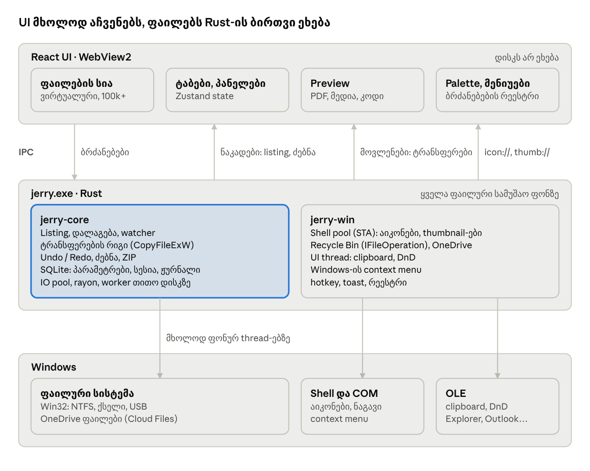

# Jerry — Tech PRD

ტექნიკური სპეციფიკაცია · Oct 31, 2026 · @Tengo

> წყარო: [Claude Doc](https://claude.ai/artifact/M8R2P7e9LGTitUdDakEAzz). ეს ფაილი მისი ასლია (ექსპორტი 04.11.2026).

## მიმოხილვა

Jerry იწყობა Tauri 2-ზე: ბირთვი Rust-ზეა, ინტერფეისი React-სა და TypeScript-ზე, მხოლოდ Windows 10/11-ისთვის. ეს დოკუმენტი აღწერს, როგორ ხორციელდება [Jerry — PRD](PRD.md)-ის მოთხოვნები. PRD ამბობს "რა", ეს დოკუმენტი კი "როგორ": ქცევის ცვლილება ჯერ PRD-ში კეთდება.

### მიღებული გადაწყვეტილებები

| გადაწყვეტილება | მიზეზი |
| --- | --- |
| სტეკი: Tauri 2, Rust, React + TypeScript. საბოლოოა, ალტერნატივები აღარ განიხილება | შეთანხმებულია 31.10.2026 |
| UI ფაილებს არ ეხება: ყველა IO Rust-ის ფონურ thread-ებზე სრულდება | PRD: ინტერფეისი არასოდეს იყინება |
| კოპირება და გადატანა საკუთარი ძრავით (`CopyFileExW`), არა Windows-ის დიალოგით | რიგი, pause/resume, Jerry-ის კონფლიქტების ფანჯარა |
| Recycle Bin-ში წაშლა `IFileOperation`-ით | Explorer-ის იდენტური შედეგი და ზუსტი Undo |
| Drag & drop და clipboard მხოლოდ Windows OLE-ით, შიგნითაც და გარეთაც | სრული თავსებადობა Explorer-თან, Outlook-თან, Telegram-თან; ერთი მექანიზმი |
| სიის მოდელი და დალაგება Rust-შია; ფილტრი, მონიშვნა და რენდერი UI-ში | 100 000 ელემენტი UI-ს არ ტვირთავს |
| ერთი SQLite ფაილი ყველა მუდმივი მონაცემისთვის | პარამეტრები, სესია და ტრანსფერების ჟურნალი ერთ ტრანზაქციულ საცავში |
| ინტერფეისი მხოლოდ ინგლისურადაა, i18n-ის გარეშე; ტექსტი მხოლოდ UI-შია, Rust აბრუნებს შეცდომის კოდს | PRD: ქართული ვერსია არ იქნება; ყველა ტექსტი ერთ ადგილას იწერება |
| ქსელი მხოლოდ განახლების შესამოწმებლად | PRD: სრულად ლოკალური, ტელემეტრიის გარეშე |
| admin-ის უფლებები არასოდეს | PRD: ჩვეულებრივი მომხმარებლის უფლებები |
| Windows 10 22H2+ და Windows 11, მხოლოდ x64 (ARM64 არა) | PRD-ის scope |
| გავრცელება საჯაროა, GitHub repo-ც საჯაროა | release-ები ხელმოწერილია code signing სერტიფიკატით; განახლებები GitHub Releases-დან მოდის |
| Replace-ით ჩანაცვლებული ფაილი Recycle Bin-ში მიდის | PRD: არაფერი იკარგება; Undo მას აბრუნებს |
| DWG preview: მხოლოდ Windows-ის thumbnail | საკუთარი DWG preview საჭირო არ არის |
| რამდენიმე ფანჯარა და ტაბის გატანა v1.0-შია | PRD-ში ეტაპი მითითებული არ იყო |
| ორპანელიანი რეჟიმი ნაგულისხმევია და v0.1-ში იწყობა; ტაბების ზოლი პანელების საზღვარზე ორად იყოფა | PRD: ნაგულისხმევად ორი პანელია |
| განახლება: შეტყობინება ახალ ვერსიაზე და Update ღილაკი | PRD: როგორც სხვა აპებში, მომხმარებლის თანხმობით |

Spike-მა (02–03.11.2026) ხუთი ტექნიკა შეცვალა: ბინარული listing, modal loop-ები Jerry-ის საკუთარი ფანჯრით, drop target-ის overlay, title bar-ის input ფანჯარა და ფონზე დარჩენა. მათი მიზეზები და უარყოფილი ალტერნატივები [ADR-ებშია](https://github.com/tshamugia/jerry/blob/main/docs/adr/README.md) (ADR-0001–0005).

## სტეკი

სტეკი ორ ნაწილად იყოფა: Rust აკეთებს ყველაფერს, რაც ფაილებსა და Windows-ს ეხება, React კი მხოლოდ აჩვენებს და მართავს. ზუსტი ვერსიები scaffold-ისას lockfile-ებში (`Cargo.lock`, `pnpm-lock.yaml`) ფიქსირდება.

### ბირთვი (Rust)

| საჭიროება | ტექნოლოგია |
| --- | --- |
| აპის ჩარჩო: ფანჯრები, IPC, ინსტალერი | Tauri 2 |
| ენა | Rust stable, edition 2024 |
| Win32, COM, Shell, OLE, Cloud Files | `windows` crate (Microsoft-ის ოფიციალური bindings) |
| ასინქრონულობა | tokio (Tauri-ს runtime) |
| პარალელური გამოთვლები: ძებნა, დალაგება | rayon |
| შენახვა | rusqlite (bundled SQLite, WAL) + rusqlite\_migration |
| ZIP | `zip` crate |
| შეცდომები | thiserror (ტიპიზებული კოდები) |
| ლოგები | tracing + tracing-appender |
| IPC ტიპები TS-ში | tauri-specta (ალტერნატივა: ts-rs) |
| Tauri plugin-ები | single-instance, global-shortcut, autostart, updater, process |

### ინტერფეისი (TypeScript)

| საჭიროება | ტექნოლოგია |
| --- | --- |
| რენდერი | WebView2 (Evergreen) |
| UI | React 19 + TypeScript (strict) + Vite |
| სტილი და თემები | Tailwind CSS 4, design tokens CSS ცვლადებად |
| კომპონენტები | Radix UI primitives, shadcn/ui-ის მოდელით (dialog, menu, tooltip, popover) |
| UI-ს აიკონები | lucide-react (ფაილების აიკონები Windows-იდან მოდის) |
| დიდი სიები | TanStack Virtual 3 |
| State | Zustand 5 |
| Command palette, Go to folder | cmdk + uFuzzy |
| შიდა გადალაგება (ტაბები, ფავორიტები, რიგი) | dnd-kit |
| ენები | არ გამოიყენება: ინტერფეისი მხოლოდ ინგლისურადაა |
| Preview | pdf.js (pdfjs-dist), react-markdown + remark-gfm, Shiki |

### ინსტრუმენტები

| საჭიროება | ტექნოლოგია |
| --- | --- |
| პაკეტები | pnpm workspace + Cargo workspace ერთ repo-ში |
| Lint და ფორმატი | Biome (TS), rustfmt + clippy (Rust) |
| ტესტები | cargo-nextest, proptest, criterion, Vitest + Testing Library, WebdriverIO + tauri-driver |
| CI და გამოშვება | GitHub Actions (windows-latest), tauri-action, git-cliff (CHANGELOG) |
| ინსტალერი | NSIS, მომხმარებლის დონეზე |

## არქიტექტურა

Jerry ერთი პროცესია (`jerry.exe`) და WebView2-ის დამხმარე პროცესები. ყველა ფაილური სამუშაო Rust-ის ფონურ thread-ებზე სრულდება, UI კი შედეგებს ნაკადად იღებს.



UI ბირთვს ბრძანებებს უგზავნის, შედეგებს კი ნაკადებით, მოვლენებითა და protocol-ებით იღებს. Windows-ს მხოლოდ ბირთვი ეხება.

### Thread-ების მოდელი

| Thread / pool | რას აკეთებს | რატომ აქ |
| --- | --- | --- |
| მთავარი (UI) thread | ფანჯრები, WebView2, clipboard, drag & drop, Windows-ის context menu | OLE-ს STA და ფანჯრის message loop სჭირდება. `OleInitialize` `setup`-ში იძახება: wry მხოლოდ `CoInitializeEx`-ს იძახებს. Modal loop-ები (drag, context menu) `async` ბრძანებიდან ეშვება და Jerry-ის საკუთარ message-only ფანჯარას ეგზავნება (`run_on_main`). Sync ბრძანება WebView2-ის IPC callback-ში სრულდება, Tauri-ს `run_on_main_thread` კი tao-ს callback-ში, სადაც tao Rust → გვერდი მოვლენებს loop-ის დასრულებამდე აჩერებს, თუ ისინი სხვა thread-იდან მოდის, მაგ. ტრანსფერის პროგრესი (spike #4, #6) |
| Shell pool (2–4 STA thread) | აიკონები, thumbnail-ები, `IFileOperation`, Shell თვისებები, OneDrive სტატუსი | Shell extension-ები STA-ს მოითხოვს; timeout იცავს, რომ ერთმა extension-მა არაფერი გაყინოს |
| IO pool | listing, კოპირება, ZIP; watcher-ს თითო საქაღალდეზე საკუთარი thread აქვს | ბლოკირებადი IO UI-ს და IPC-ს არ აჩერებს |
| ტრანსფერის worker-ები | ერთი worker თითო ფიზიკურ დისკზე ან ქსელურ სერვერზე | ერთ დისკზე თანმიმდევრულად, სხვადასხვაზე პარალელურად (PRD) |
| CPU pool (rayon) | ძებნის walker, დალაგება | ყველა ბირთვი |
| tokio runtime | IPC ბრძანებები, მოვლენების გაგზავნა | ასინქრონული ორკესტრაცია |

### Repo-ს სტრუქტურა

```
jerry/
  src/                 React UI
  src-tauri/           Tauri აპი: main, ფანჯრები, IPC ბრძანებები, მოვლენები, protocol-ები
  crates/
    jerry-core/        listing, დალაგება, watcher, ტრანსფერები, Undo, ძებნა,
                       გადარქმევა, ZIP, შენახვა (COM-ის გარეშე, ტესტირებადი)
    jerry-win/         Shell და COM: აიკონები, thumbnail-ები, Recycle Bin, clipboard,
                       drag & drop, context menu, OneDrive, დისკები, რეესტრი, toast
  docs/                ADR-ები, ხელით ტესტირების ჩეკლისტები
```

`jerry-core` არ იცის Tauri-ს და UI-ს შესახებ: მისი ტესტირება შესაძლებელია ჩვეულებრივ დროებით საქაღალდეებზე. `jerry-win` ერთადერთი ადგილია, სადაც COM-ის წესები (apartment, lifetime) დაცულია.

### მონაცემთა ნაკადი: საქაღალდის გახსნა

1. UI იძახებს `listing_open(tab, path)`-ს და იღებს ნაკადს (Channel).
2. ბირთვი IO pool-ზე კითხულობს საქაღალდეს და აგზავნის batch-ებს: პირველს 256 ელემენტზე (100 000-იან საქაღალდეში ~1 ms-ში), შემდეგებს 50 ms-ში ერთხელ, დანარჩენს ბოლოს (spike #2). გაშვებისას სესიის საქაღალდეების listing პროცესის დაწყებისთანავე იწყება, Tauri-მდე: Rust შეტყობინებებს აგროვებს და UI-ს channel-ის მიბმისთანავე უგზავნის (spike #1).
3. ბირთვი ალაგებს და UI-ს უგზავნის ელემენტებს და მათ თანმიმდევრობას.
4. UI ხატავს მხოლოდ ხილულ რიგებს; მათი აიკონები და thumbnail-ები იტვირთება `icon://` და `thumb://` მისამართებით.
5. Watcher აგროვებს ცვლილებებს 100 ms-ის განმავლობაში და იმავე ნაკადში აგზავნის diff-ს.
6. ტაბის დახურვისას ან სხვა საქაღალდეში გადასვლისას UI იძახებს `listing_close`-ს და watcher ჩერდება.

## Rust ბირთვი (jerry-core)

ბირთვი ფლობს ყველა ფაილურ ოპერაციას და მათ უსაფრთხოებას; UI მას აძლევს ბრძანებას და იღებს შედეგს.

### Listing

- `FindFirstFileExW` (`FindExInfoBasic`, `FIND_FIRST_EX_LARGE_FETCH`): სახელი, ზომა, თარიღები და ატრიბუტები ერთი გამოძახებით, ფაილის გახსნის გარეშე.
- ყოველ ელემენტს listing-ის ფარგლებში სტაბილური `entry_id` აქვს. UI ოპერაციებში id-ს გადასცემს, ბირთვი კი ზუსტ `OsString` გზას ინახავს. ასე Windows-ის იშვიათი, არავალიდური UTF-16 სახელებიც უსაფრთხოდ მუშავდება.
- ნელი დისკი (ქსელი, USB): listing გაუქმებადი task-ია, UI ჩატვირთვის ინდიკატორს აჩვენებს და სხვა ტაბები მუშაობს.
- საქაღალდის ზომა მხოლოდ მოთხოვნით ითვლება (Calculate size), ფონზე, ძებნის walker-ით.

### დალაგება

- ბუნებრივი დალაგება Explorer-ის წესით (`StrCmpLogicalW`-ის სემანტიკა): file2 დგას file10-მდე. Spike #8-ში ქართული სახელების ნაკრების (მთავრული, ხუცური, emoji, სრული სიგანის ციფრები) 780-ივე წყვილი `StrCmpLogicalW`-ს ემთხვევა.
- სახელს ერთხელ ექმნება sort key, რომ დალაგების შეცვლა სწრაფი იყოს. სამიზნე: 100 000 ელემენტი 100 ms-ზე ნაკლებში. Spike #2-ში 100 000-ზე Rust-ის sort 2.9 ms-ია, დალაგების შეცვლა კლიკიდან paint-მდე ~30 ms. Key არის `LCMapStringEx(LCMAP_SORTKEY | NORM_IGNORECASE | SORT_DIGITSASNUMBERS)` მომხმარებლის locale-ით: listing-ის ბოლოს ერთხელ იქმნება, rayon-ით. დალაგების შეცვლა სტრიქონებს აღარ ადარებს, მხოლოდ `u128` რიცხვებს (ჯგუფი, მნიშვნელობა, სახელის rank). #26-ში აპში 100 000-ის დალაგების შეცვლა კლიკიდან paint-მდე 15.6 ms-ია (მედიანა, max 32.6 ms; debug-ში 32.0 / 38.1 ms), ბირთვში index 12 ms, ერთი დალაგება 1.2–1.5 ms. #27-დან order listing-ის ნაკადით მოდის: კლიკიდან paint-მდე 15–31 ms (სვეტების მედიანა, max 33 ms, release).
- დალაგების შეცვლისას (`listing_sort(id, sort)`, `sort` = სვეტი, მიმართულება, საქაღალდეები წინ) UI-ს ეგზავნება მხოლოდ ახალი თანმიმდევრობა (`u32` ინდექსების ბინარული მასივი listing-ის ნაკადით; 100 000-ზე 400 KB), ელემენტები არა. თარიღით დალაგება ზუსტ `u64` FILETIME-ზე ხდება.
- საქაღალდეები ფაილებზე წინ (პარამეტრი).
- სვეტები: სახელი, შეცვლის თარიღი, ტიპი, ზომა, შექმნის თარიღი, გაფართოება. კლებადი ზრდადის შებრუნებულია, საქაღალდეები კი წინ რჩება; ტოლ მნიშვნელობებს სახელი ალაგებს. Type ტიპის სახელით ლაგდება (`TypeNames` trait): Shell-ის სახელს (`SHGFI_TYPENAME`, მაგ. "AutoCAD Drawing") `jerry-win` მისცემს, მანამდე Explorer-ის სახელებია დაურეგისტრირებელი ტიპებისთვის ("PDF File", "File", "File folder"). გაფართოება სახელის ბოლო წერტილის შემდეგ იწყება.

### Watcher

- `ReadDirectoryChangesW` ყოველ ღია საქაღალდეზე, საკუთარ thread-ზე (არა tokio-ზე). ერთი საქაღალდე რამდენიმე ტაბში ერთ watcher-ს იზიარებს; ბოლო `listing_close` მას აჩერებს. Watcher listing-ის წაკითხვამდე ირთვება, ამიტომ წაკითხვისას მომხდარი ცვლილებაც არ იკარგება: ის done-ის შემდეგ diff-ად მოდის.
- საქაღალდე იხსნება ყველა share რეჟიმით და `FILE_FLAG_BACKUP_SEMANTICS`-ით: Explorer მას გადაარქმევს და წაშლის. მის ზემოთ მდგომ საქაღალდეს NTFS ვერ გადაარქმევს, სანამ ქვემოთ რამე ღიაა, share რეჟიმის მიუხედავად; იგივე ხდება Explorer-ის ფანჯრითაც (შემოწმდა 04.11.2026).
- ცვლილებები გროვდება 100 ms პირველი ცვლილებიდან და იგზავნება diff-ად: დამატებული, წაშლილი, შეცვლილი და ახალი თანმიმდევრობა. შეცვლილი სახელი ერთ-ერთად მოწმდება (`FindFirstFileExW` ზუსტ სახელზე), ასე 8.3 მოკლე სახელიც და მხოლოდ case-ის ცვლილებაც სწორ ელემენტს პოულობს.
- `entry_id` სტაბილურია: შეცვლილი და გადარქმეული ელემენტი id-ს ინარჩუნებს, ახალი შემდეგ id-ს იღებს, წაშლილის id აღარ მეორდება. დალაგების index სახელების ცვლილებისას თავიდან იქმნება, წაშლისას იფილტრება, ზომის ან თარიღის ცვლილებისას იგივე რჩება.
- Buffer-ის გადავსება (64 KB, ქსელის ზღვარი), ერთ ჯერზე 4 096-ზე მეტი სახელი, ან ქსელური გაზიარება შეტყობინებების გარეშე: სრული ხელახალი listing, სახელით შედარებული (გადარქმევა მაშინ წაშლა და დამატებაა). შეტყობინებების გარეშე საქაღალდე ხელახლა იკითხება ყოველ 5 s-ში, ან listing-ის ოთხმაგ დროში, თუ ის მეტია.
- საქაღალდე წაიშალა, გადაერქვა ან გადავიდა (`GetFinalPathNameByHandleW` ყოველ 2 s-ში), ან დისკი გაითიშა: ნაკადი `NotFound` ან `DeviceGone` error-ით მთავრდება.
- ღია watcher USB დისკის "Safely remove"-ს აბრკოლებს, სანამ listing ღიაა. გამოსავალი: `DBT_DEVICEQUERYREMOVE` `jerry-win`-ში, რომ იმ დისკის watcher-ები დაიხუროს (ცალკე issue).
- #27-ში (release, Intel Core Ultra 9 185H) გარედან შექმნილი, გადარქმეული, წაშლილი ან შეცვლილი ფაილი dev ხედში ჩანს 118–122 ms-ში (მედიანა) 1 000-იან საქაღალდეში და 124–136 ms-ში (max 186 ms) 100 000-იანში. 100 000-იან საქაღალდეში 2.2 s-ში შექმნილ 10 000 ფაილს ხედი ბოლო ფაილიდან 0.3 s-ში ითვლის, მათ წაშლას (3.2 s) 0.1 s-ში; long task (≥ 50 ms) არცერთი.

### ტრანსფერების ძრავი

ყოველი კოპირება და გადატანა job-ია რიგში: დათვლა, ადგილის შემოწმება, შესრულება, შეჯამება. ისივე რიგით მუშაობს drag & drop, ZIP და დიდი Undo.

- **რიგები:** ერთი worker თითო ფიზიკურ დისკზე (volume → disk, `IOCTL_VOLUME_GET_VOLUME_DISK_EXTENTS`), ქსელისთვის თითო სერვერზე. რიგის თანმიმდევრობა იცვლება.
- **ადგილი:** დაწყებამდე `GetDiskFreeSpaceExW`; თუ არ კმარა, job არ იწყება.
- **კოპირება:** `CopyFileExW` progress callback-ით: პროცენტი, სიჩქარე, pause (callback ელოდება), cancel. დიდ ფაილებზე `COPY_FILE_NO_BUFFERING`.
- **უსაფრთხო ჩაწერა:** ფაილი ჯერ იწერება დროებით სახელზე (`name.ext.jerrypart`, hidden) და დასრულების შემდეგ ერქმევა საბოლოო სახელი. ნახევრად დაკოპირებული ფაილი საბოლოო სახელით არასოდეს ჩნდება.
- **Replace:** ჩანაცვლებული ფაილი Recycle Bin-ში იგზავნება, რომ Undo-ით დაბრუნდეს.
- **იმავე volume-ზე გადატანა:** `MoveFileExW`, მყისიერი, საქაღალდეებიც.
- **სხვა დისკზე გადატანა:** სრული ასლი → ზომის შემოწმება → მხოლოდ ამის შემდეგ წყაროს წაშლა.
- **კონფლიქტი:** აჩერებს მხოლოდ თავის job-ს. "Apply to all" ინახება job-ის პოლიტიკაში. საქაღალდეს კონფლიქტზე: Merge ან Keep both.
- **შეცდომა ფაილზე:** იწერება სიაში, job გრძელდება; ბოლოს Retry მხოლოდ წარუმატებლებზე.
- **დისკი ან ქსელი გაითიშა:** job პაუზდება და ელოდება დაბრუნებას; შემდეგ Resume ან Cancel.
- **საკუთარ თავში კოპირება:** იბლოკება; გზები ედარება `GetFinalPathNameByHandleW`-ით, junction-ების გათვალისწინებით.
- **პროგრესი:** UI-ს ეგზავნება მაქსიმუმ 10-ჯერ წამში.
- **ჟურნალი:** ყოველი job-ის მდგომარეობა SQLite-ში crash recovery-სთვის.

### Undo და Redo

ყოველი დასრულებული ოპერაცია მეხსიერებაში იწერება ინვერსიული მოქმედებების სიად. ინახება ბოლო 50, მხოლოდ სესიის განმავლობაში (PRD).

| ოპერაცია | Undo | რა ინახება |
| --- | --- | --- |
| გადარქმევა, ჯგუფურიც | ძველი სახელები | წყვილები: ახალი → ძველი |
| გადატანა | უკან გადატანა | წყვილები: დანიშნულება → წყარო |
| კოპირება | ასლები Recycle Bin-ში | შექმნილი გზები |
| წაშლა Recycle Bin-ში | აღდგენა ადგილზე | Recycle Bin-ის ელემენტი, რომელსაც `IFileOperation`-ის `PostDeleteItem` აბრუნებს |
| ახალი საქაღალდე ან ფაილი | წაშლა, თუ ცარიელია | გზა |
| ZIP-ის შექმნა ან ამოღება | შედეგი Recycle Bin-ში | შექმნილი გზები |

- Undo-მდე ყოველი ფაილი მოწმდება: file ID, ზომა და შეცვლის დრო უნდა ემთხვეოდეს. შეცვლილი ფაილი გამოიტოვება და მიზეზი ჩანს.
- დიდი Undo (მაგ. 10 GB-ის გადატანის დაბრუნება სხვა დისკიდან) ტრანსფერების რიგში მიდის.

### ძებნა

- საკუთარი პარალელური walker `FindFirstFileExW`-ზე, rayon-ის work-stealing-ით.
- ფილტრები: სახელი (ნაწილობრივი, wildcard, რამდენიმე სიტყვა), ტიპების ჯგუფები, ზომა, თარიღი, ფაილი ან საქაღალდე.
- შედეგები ნაკადად, batch 50 ms-ში ერთხელ, სტატუსით (ნაპოვნია, შემოწმებულია). Stop აჩერებს cancel token-ით.
- Symlink და junction ნაგულისხმევად არ იხსნება; თუ იხსნება, წრეებისგან იცავს volume-ის და file ID-ის სია.
- OneDrive-ზე იკითხება მხოლოდ მეტამონაცემები, შიგთავსი არასოდეს.
- Windows, Program Files და ProgramData ნაგულისხმევად გამორიცხულია.

### გადარქმევა

- სახელის ვალიდაცია ერთი წესებით ორ ადგილას: TS-ში აკრეფისას, Rust-ში საბოლოოდ. იბლოკება აკრძალული სიმბოლოები, დაცული სახელები (CON, NUL, COM1…), ბოლოს წერტილი ან ჰარი.
- Batch rename: ცხრილი "Before → After" TS-ში ითვლება მყისიერად. შესრულება Rust-შია, ორ ფაზად (ჯერ დროებით სახელებზე), რომ a ↔ b გაცვლამაც იმუშაოს. ერთი Undo მთელ ჯგუფზე.
- მხოლოდ რეგისტრის შეცვლა (`file.txt` → `File.txt`) მუშაობს.

### ZIP

- `zip` crate; შექმნა და ამოღება ტრანსფერების რიგში მიდის, პროგრესით და cancel-ით.
- სახელები UTF-8 flag-ით იწერება, რომ ქართული სახელები სწორად გაიხსნას. ძველ არქივებში fallback OEM codepage-ზე.
- ამოღებისას zip-slip დაცვა: `..` და აბსოლუტური გზები იბლოკება.
- ZIP-ის შიგნით ნავიგაცია: ვირტუალური listing, მხოლოდ წასაკითხად.

### დისკები

- სია და ადგილი: `GetLogicalDrives`, `GetDriveTypeW`, `GetDiskFreeSpaceExW`; ქსელური დისკები `WNetGetConnectionW`-ით.
- USB-ის ჩართვა და გამოღება: `WM_DEVICECHANGE`.
- Eject: Shell-ის "Eject" ბრძანება დისკის ელემენტზე; აქტიური ტრანსფერისას ჯერ გაფრთხილება.

## Windows ინტეგრაცია (jerry-win)

Windows-თან ყველა შეხება ერთ crate-შია, რომ COM-ის წესები ერთ ადგილას იყოს. პრინციპი: Jerry იქცევა ისე, როგორც Explorer, და სადაც შესაძლებელია, იგივე Shell API-ს იყენებს.

### აიკონები და thumbnail-ები

- ფაილის აიკონი: `SHGetFileInfoW` + `SHGFI_USEFILEATTRIBUTES` გაფართოებით, დისკზე წვდომის გარეშე. შედეგი system image list-ის ინდექსია და ქეშდება მისი მიხედვით.
- ინდივიდუალური აიკონი მხოლოდ .exe, .lnk, .ico და .url ფაილებს აქვთ.
- Thumbnail: `IShellItemImageFactory::GetImage` Shell pool-ზე, timeout-ით. cloud-only ფაილებზე `SIIGBF_INCACHEONLY`, რომ ჩამოტვირთვა არ დაიწყოს.
- UI მათ იღებს `icon://` და `thumb://` custom protocol-ით. WebView2 თავად ქეშავს და ტვირთავს მხოლოდ ხილულ რიგებს. Thumbnail-ის მისამართში შეცვლის დროა, რომ შეცვლილი ფაილი თავიდან ჩაიტვირთოს.
- საკუთარი disk cache არ არის: Windows-ს უკვე აქვს thumbcache. ზომა ითვლება ეკრანის DPI-ის მიხედვით.

### Clipboard

- Copy და Cut: Explorer-ის Shell data object, CF\_HDROP-ით და Shell IDList Array-ით: `SHCreateShellItemArrayFromIDLists` + `BindToHandler(BHID_DataObject)`, ანუ მშობელი საქაღალდის `GetUIObjectOf`. `SHCreateDataObject` ცარიელ ობიექტს აბრუნებს და არ გამოიყენება (spike #3). `Preferred DropEffect` Explorer-ივით იწერება: Copy = COPY | LINK (5), Cut = MOVE (2). Clipboard-ზე დადებული `IDataObject` მთავარი thread-ის COM ობიექტია და main-thread `thread_local`-ში ინახება. Core-ის `\\?\` პრეფიქსი Shell-ისთვის და CF\_HDROP-ისთვის იშლება: Shell MAX\_PATH-ზე გრძელ ჩვეულებრივ გზას ამუშავებს, `\\?\` გზას კი ვერა. Jerry-ს დახურვისას `OleFlushClipboard`, რომ შიგთავსი დარჩეს: მის გარეშე CF\_HDROP ქრება, flush-ის შემდეგ კი Cut ისევ Cut რჩება (spike #5).
- Paste: CF\_HDROP + `Preferred DropEffect`: MOVE COPY-ის გარეშე = Cut, დანარჩენი Copy. Explorer-იდან ამოჭრილის გადატანის შემდეგ Jerry წერს `Paste Succeeded = MOVE`-ს (`Performed DropEffect`-ის გარეშე) და clipboard-ს თავად ასუფთავებს, თუ `GetClipboardSequenceNumber` არ შეცვლილა: Explorer, როგორც წყარო, `Paste Succeeded`-ზე არ რეაგირებს. Explorer-ში ჩასმული Cut-ის შემდეგ Explorer წერს `Performed DropEffect = MOVE`-ს; Jerry ამაზე არაფერს შლის (ფაილები Explorer-მა უკვე გადაიტანა), მხოლოდ ამოჭრის სტილს აქრობს.
- Virtual files (`FileGroupDescriptorW` + `FileContents`): Outlook-ის attachment ინახება ფაილად.
- Paste as: სურათი (PNG ან CF\_DIBV5) → .png, ტექსტი → .txt.
- `AddClipboardFormatListener` Jerry-ის message-only ფანჯარაზე, მთავარ thread-ზე. ცვლილებისას Jerry ამოწმებს `OleIsCurrentClipboard`-ს (export პირდაპირ იძახება: `windows` crate `S_FALSE`-ს `Ok`-ად აქცევს) და, თუ clipboard მისი აღარ არის, `clipboard:changed`-ით ამოჭრილი ფაილების ნახევრად გამჭვირვალე სტილი ქრება. `WM_CLIPBOARDUPDATE` Jerry-ის საკუთარ ცვლილებაზეც მოდის, ამიტომ ამოჭრის მდგომარეობა `OleSetClipboard`-მდე იწერება.

### Drag & drop

Jerry იყენებს მხოლოდ Windows OLE drag & drop-ს, შიგნითაც და გარეთაც. ამიტომ Jerry-დან გადათრეული ფაილი ყველა პროგრამისთვის Explorer-ის ფაილივია.

- **გადათრევა Jerry-დან:** UI ამჩნევს მაუსის მოძრაობას ზღვარზე მეტად და იძახებს `drag_start(ids)`-ს. ეს `async` ბრძანებაა: tokio pool-იდან drag Jerry-ის საკუთარ ფანჯარას ეგზავნება (`run_on_main`, იხ. «Thread-ების მოდელი»), ასე modal loop მთავარ thread-ზე ეშვება, WebView2-ისა და tao-ს callback-ების გარეთ. იქ ეშვება `SHDoDragDrop` Explorer-ის Shell data object-ით (იხ. Clipboard) და default drop source-ით; drag image და რაოდენობის ბეჯი Windows-ისაა. გვერდი drag-ის შემდეგ `pointerup`-ს არ იღებს, ამიტომ UI drag-ის მდგომარეობას `drag_start`-ის დასრულებისას ასუფთავებს. შემოწმებულია spike #3-ით: Explorer, Desktop, Outlook, Telegram, Chrome და AutoCAD ფაილს ისე იღებს, როგორც Explorer-იდან.
- **მიღება:** საკუთარი `IDropTarget`, მაგრამ არა WebView2-ის ფანჯარაზე. კურსორის ქვეშ ყოველთვის WebView2-ის browser პროცესის ფანჯარაა (`Chrome_WidgetWin_1`, `Chrome_RenderWidgetHostHWND`), და OLE მისგან Jerry-ის ფანჯრებამდე ზემოთ არ ადის: Jerry-ის ფანჯარაზე რეგისტრირებული target გვერდის თავზე არასოდეს გამოიძახება, Tauri-ს ჩაშენებული drop handler-იც არა (spike #4). ამიტომ target გამჭვირვალე owned popup-ზეა (layered, alpha 1/255, არ აქტიურდება), რომელიც გვერდის თავზე მხოლოდ drag-ის დროს ჩნდება. ტაიმერი (50 ms, დაჭერილი ღილაკისას 16 ms) მას აჩენს, როცა Jerry-ს გარეთ დაჭერილი ღილაკით კურსორი Jerry-ზეა ან Jerry-ის საკუთარი drag მიდის. Tauri-ს drop handler გამორთულია (`dragDropEnabled: false`), WebView2-ის `AllowExternalDrop` კი ითიშება, რომ გვერდმა ჩაგდებული ფაილი არ მიიღოს და არ გახსნას. Drag image სამიზნეზე მხოლოდ `IDropTargetHelper`-ით ჩანს.
- **სამიზნის პოვნა:** OLE drag-ის დროს WebView2 მაუსის მოვლენებს ვერ იღებს. ამიტომ Rust აგზავნის `dnd:over {seq, x, y, keys}`-ს (client პიქსელებში, COM გამოძახების გარეთ), UI კი `elementFromPoint`-ით პოულობს სამიზნეს (საქაღალდე, ტაბი, breadcrumb, sidebar) და `dnd_answer`-ით აბრუნებს. მოქმედებას Rust ითვლის. Round trip: მედიანა 4–5 ms (spike #4).
- **`DragOver`** სინქრონულად აბრუნებს მოქმედებას UI-ს ბოლო პასუხით და მიმდინარე ღილაკებით: სამიზნე ერთი კადრით აგვიანებს, Ctrl, Shift და Alt კი მაშინვე მოქმედებს.
- **Drop description** ("Move to Drawings"): `DROPDESCRIPTION` + `IDropTargetHelper`, ტექსტი UI-დან მოდის. სადაც Jerry ჩაგდებას არ იღებს, `DROPIMAGE_NONE` უტექსტოდ, თორემ Windows თავის "+ Copy"-ს წერს.
- **UI-ს ლოგიკა იმავე მოვლენებზე:** spring-loaded folders, ტაბზე 0.7 წმ გაჩერება, კიდესთან auto-scroll.
- **მოქმედება:** იმავე volume → move, სხვა → copy; Ctrl → copy, Shift → move, Alt ან Ctrl+Shift → link. იძულებითი მოქმედება, რომელსაც წყარო არ უშვებს, უარყოფილია; ნაგულისხმევი კი დაშვებულზე გადადის (Outlook და ბრაუზერი მხოლოდ copy-ს უშვებს). მარჯვენა ღილაკით გადათრევა მენიუს აჩვენებს: `Drop` მაშინვე ბრუნდება, მენიუ Jerry-ისაა.
- **ჩაგდების შემდეგ:** CF\_HDROP → ტრანსფერების რიგი. გადატანას Jerry თვითონ აკეთებს (optimized move): `Drop` აბრუნებს NONE-ს ან COPY-ს და წერს `Performed DropEffect = NONE`-ს, რომ წყარომ არაფერი წაშალოს. Virtual files (Outlook, ბრაუზერი): `Drop`-ში მხოლოდ `FileContents`-ის reference-ები აიღება (`AgileReference`), ფაილი worker thread-ზე იწერება `.jerrypart`-ით; IStorage → `.msg`, async წყაროს `StartOperation`/`EndOperation`. სახელი ZIP-ის წესით მოწმდება: `..` და აბსოლუტური გზა იბლოკება.
- **შიდა გადალაგება** (ტაბები, ფავორიტები, რიგი) dnd-kit-ით კეთდება, OLE-ს გარეშე. ტაბის ფანჯრიდან გატანისას კურსორს ფანჯრის გარეთ Rust ადევნებს თვალს.

### Context menu

- Jerry-ის საკუთარი მენიუ React-შია (Radix), ყოველ ბრძანებასთან shortcut-ით.
- "Windows options…" Explorer-ის კლასიკური მენიუა ("Show more options"), Windows 11-ის packaged handler-ებითაც (WinRAR, Notepad, Terminal): `IShellFolder::GetUIObjectOf` → `IContextMenu` → `QueryContextMenu` (`CMF_NORMAL | CMF_CANRENAME | CMF_ITEMMENU`, Shift-ით `CMF_EXTENDEDVERBS`) → `TrackPopupMenuEx(TPM_RETURNCMD)` მთავარ ფანჯარაზე. `async` ბრძანება მენიუს `run_on_main`-ით უშვებს (იხ. «Thread-ების მოდელი») და მისი დახურვისას ბრუნდება.
- ფანჯრის subclass (`SetWindowSubclass`, მხოლოდ მენიუს დროს) გადასცემს `WM_INITMENUPOPUP`, `WM_DRAWITEM`, `WM_MEASUREITEM` და `WM_MENUCHAR`-ს `IContextMenu3::HandleMenuMsg2`-ს (ან `IContextMenu2`-ს). მის გარეშე ცარიელი რჩება ქვემენიუები, რომლებიც გახსნისას ივსება: WinRAR, "Open with", "Give access to". "Send to" Windows 11-ზე მენიუს message loop-იდან ივსება (spike #6).
- არჩეული ბრძანება: `InvokeCommand` (`CMINVOKECOMMANDINFOEX`: Unicode, `PTINVOKE`, `ASYNCOK`, Shift და Ctrl, მშობელი საქაღალდე სამუშაო დირექტორიად). Jerry-ის საკუთარი verb-ები (`rename`, `delete`, `cut`, `copy`, `paste`, საქაღალდეზე `open`) Shell-ს არ ეგზავნება და Jerry-ის ბრძანებით სრულდება (Undo, ჟურნალი, ამოჭრის სტილი). Shell-ის `rename` Explorer-ის view-ს ითხოვს და Jerry-ში არაფერს აკეთებს.
- `QueryContextMenu` ყველა handler-ს ტვირთავს და მთავარ thread-ს ბლოკავს, timeout-ის გარეშე (როგორც Explorer-ში): პროცესში პირველად ~0.5 წმ, შემდეგ 64–125 ms. პირველ მენიუს packaged handler-ები ზოგჯერ აკლია. ამიტომ გაშვების შემდეგ Shell pool-ის thread-ზე Jerry ერთხელ აგებს და აგდებს საკუთარი exe-სა და მისი საქაღალდის მენიუს (prewarm, ~1.3 წმ ფონზე, მომხმარებლის ფაილს არ ეხება): ამის შემდეგ პირველი მენიუც სწრაფი და სრულია.
- მუქი რეჟიმი: Win32 მენიუ ღია რჩება, სანამ Jerry uxtheme-ის დოკუმენტაციის გარეშე ordinal-ებს არ გამოიძახებს: `SetPreferredAppMode(AllowDark)` #135, `AllowDarkModeForWindow` #133, `FlushMenuThemes` #136 (Windows 10 1903-დან უცვლელი, Explorer-იც ასე აკეთებს). ასე მენიუ Windows-ის რეჟიმს მიჰყვება.
- MAX\_PATH-ზე გრძელი გზა: core-ის `\\?\` Shell-ისთვის იშლება, მაგრამ handler-ები ფაილს 8.3 მოკლე სახელით იღებენ ("Send to → Compressed" ქმნის `F808~1.zip`-ს). Jerry ასეთ ელემენტზე "Windows options…"-თან შენიშვნას აჩვენებს.
- ძებნის შედეგებში სხვადასხვა საქაღალდის ფაილების მონიშვნისას Windows-ის მენიუ მიუწვდომელია, განმარტებით (`ILIsParent` ამოწმებს).

### გახსნა

- Open: `ShellExecuteExW` ნაგულისხმევი verb-ით.
- Open with: `SHAssocEnumHandlers` (რეკომენდებული პროგრამები) + ბოლოს გამოყენებული SQLite-დან. "სხვა პროგრამა…" ხსნის `SHOpenWithDialog`-ს.
- Open in Terminal: `wt.exe -d <path>`, თუ არ არის, PowerShell.
- Show in Explorer: `SHOpenFolderAndSelectItems`.
- "Open in…" ბრძანებები: პროგრამა + არგუმენტების შაბლონი (`{path}`), გაშვება `CreateProcessW`-ით.
- "ფაილი სხვა პროგრამაშია გახსნილი": პროგრამის სახელს Restart Manager (`RmGetList`) აბრუნებს.

### Recycle Bin

- წაშლა: `IFileOperation` დროშებით `FOFX_RECYCLEONDELETE`, `FOF_ALLOWUNDO`, `FOF_NO_UI`. `PostDeleteItem` აბრუნებს Recycle Bin-ში მოხვედრილ ელემენტს, რომელსაც Undo იყენებს.
- ქსელურ და მოსახსნელ დისკებს Recycle Bin არ აქვთ: Jerry წინასწარ აფრთხილებს და სამუდამო წაშლას ადასტურებით აკეთებს.
- სამუდამო წაშლა (Shift+Del): საკუთარი რეკურსიული წაშლა, რომელიც გრძელ გზებსაც იღებს.
- Recycle Bin-ის ხედი: Shell folder `FOLDERID_RecycleBinFolder`, თვისებებით "ორიგინალი მისამართი" და "წაშლის თარიღი". Restore იყენებს undelete verb-ს, Empty — `SHEmptyRecycleBinW`-ს.

### OneDrive

- სტატუსი ფაილის ატრიბუტებიდან იკითხება, რომლებიც listing-თან ერთად მოდის: `RECALL_ON_DATA_ACCESS` (მხოლოდ cloud-ში), `PINNED` (ყოველთვის მოწყობილობაზე), `UNPINNED`. დამატებითი გამოძახება არ სჭირდება.
- "სინქრონიზდება" სტატუსი: Shell property `System.StorageProviderState`, მხოლოდ ხილული რიგებისთვის, Shell pool-ზე.
- "Always keep on this device" და "Free up space": `CfSetPinState`.
- წესი: Jerry არასოდეს კითხულობს cloud-only ფაილის შიგთავსს მომხმარებლის მოქმედების გარეშე. Preview ასეთ ფაილზე წერს "ფაილი მხოლოდ cloud-შია".

### სისტემური ინტეგრაცია

- გლობალური hotkey: `tauri-plugin-global-shortcut` (`RegisterHotKey`), ნაგულისხმევად Ctrl+Alt+J.
- ერთი ეგზემპლარი: `tauri-plugin-single-instance`; მეორე გაშვების გზა იხსნება ახალ ტაბში ბოლო აქტიურ ფანჯარაში.
- Autostart: `tauri-plugin-autostart` (HKCU Run) `--background` არგუმენტით. ფანჯარა დამალული იქმნება და hotkey-ზე მყისიერად ჩნდება.
- "Open in Jerry": ჩანაწერები `HKCU\Software\Classes`-ში (`Directory\shell`, `Directory\Background\shell`, `Drive\shell`), admin-ის გარეშე. Windows 11-ის ახალ მენიუში გამოსაჩენად v1.0-ში ემატება sparse package (package identity), იმავე code signing სერტიფიკატით; მანამდე ჩანაწერი "Show more options"-ში ჩანს.
- შეტყობინებები: WinRT `ToastNotification` (`windows` crate); დაჭერა (`Activated`) ხსნის დანიშნულების საქაღალდეს. AUMID რეგისტრირდება ინსტალერის shortcut-ით.
- Taskbar-ის პროგრესი: Tauri-ს `set_progress_bar` (`ITaskbarList3`).
- გრძელი გზები: მანიფესტში `longPathAware`, ბირთვი `\\?\` გზებს იყენებს. Shell API-ები 260+ სიმბოლოზე ზოგჯერ ვერ მუშაობს; ასეთ დროს Jerry საკუთარ ოპერაციას იყენებს.

## ინტერფეისი (React)

თითოეულ ფანჯარაში React-ის ერთი აპია, რომელიც მხოლოდ აჩვენებს და მართავს. ფაილებს ის თავად არასოდეს ეხება.

### სტრუქტურა

```
src/
  app/        ფანჯრის ჩარჩო: title bar ტაბებით, layout, ზონების ზომები
  features/   navigation, tabs, file-list, selection, transfers, search,
              preview, sidebar, palette, rename, settings, history
  commands/   ბრძანებების რეესტრი და keymap
  ipc/        tauri-specta-ს გენერირებული bindings და wrapper-ები
  stores/     Zustand store-ები
  strings/    UI-ს ტექსტები და შეცდომების შეტყობინებები (English)
  ui/         საერთო კომპონენტები (Radix, shadcn-ის მოდელით)
```

### State

- Store-ები: ფანჯარა (ნაგულისხმევად ორი პანელი, თითოეულს საკუთარი ტაბები; აქტიური პანელი), ტაბი (ისტორია, ხედი, დალაგება, ფილტრი, scroll, მონიშვნა), ტრანსფერები, პარამეტრები, ფავორიტები.
- მუდმივი მონაცემების წყარო Rust-ია. UI ცვლილებას ბრძანებით აგზავნის, ყველა ფანჯარა კი `settings:changed` მოვლენით ახლდება.
- მონიშვნა: `Set<entry_id>` და anchor. Invert და Select by pattern UI-ში სრულდება.
- სესია ინახება ყოველი ცვლილებისას, 1 წამის debounce-ით, რომ ავარიული დახურვის შემდეგაც აღდგეს.

### ფაილების სია

- TanStack Virtual: Details (რიგები), List (სვეტები), Grid (ბადე). რიგის სიმაღლე ფიქსირებულია სიმჭიდროვის მიხედვით, ამიტომ scroll-ის გამოთვლა მყისიერია.
- სწრაფი ფილტრი (Ctrl+F) UI-შია. სამიზნე: 100 000 სახელის შემოწმება ერთ კადრში (16 ms).
- რიგის კომპონენტი memo-ითაა; მონიშვნის შეცვლა მხოლოდ შეცვლილ რიგებს ხატავს.
- გადარქმევა სიაშივეა (inline input), ვალიდაციით აკრეფისას.

### ფანჯარა და ტაბები

- `decorations: false`. ტაბები და Windows-ის ღილაკები React-შია (ტაბების ზოლი პანელების საზღვარზე ორად იყოფა: თითოეული პანელის ტაბები და მისამართის ზოლი მის ზემოთაა; title bar-სა და body-ს საერთო grid სვეტები აქვს, ამიტომ ზოლი გამყოფის გადაწევას მიჰყვება). ცარიელი ადგილი CSS `app-region: drag`-ია (ტაბებსა და ღილაკებზე `no-drag`): WebView2-ის `IsNonClientRegionSupportEnabled`-ით (wry რთავს) გადათრევას, Aero Snap-ს, ორმაგ კლიკს და system menu-ს WebView2 native-ად აკეთებს, ამიტომ `data-tauri-drag-region` და `core:window:*` permission არ სჭირდება (spike #7).
- Caption ღილაკებს (46×40) React ხატავს, თაგვს კი `jerry-win`-ის უხილავი input ფანჯარა იღებს ღილაკების თავზე (`WS_EX_LAYERED | WS_EX_NOREDIRECTIONBITMAP` child, Windows Terminal-ის მოდელი): top-level ფანჯრის `WM_NCHITTEST` გვერდის თავზე არ მოდის, რადგან WebView2-ის ფანჯრები browser process-ს ეკუთვნის. Input ფანჯარა აბრუნებს `HTMINBUTTON` / `HTMAXBUTTON` / `HTCLOSE`-ს (Windows 11-ის Snap Layouts ამას ითხოვს), კლიკზე parent-ს `WM_SYSCOMMAND`-ს უგზავნის, hover / pressed / maximized / active მდგომარეობას კი `Channel`-ით React-ს. Maximize-ის ზომას tao-ს `WM_NCCALCSIZE` სამუშაო არით ზღუდავს. Mica: `transparent: true` + `DWMWA_SYSTEMBACKDROP_TYPE = DWMSBT_MAINWINDOW` build 22621+-ზე; Windows 10-ზე `--jerry-mica` ერთფეროვანი ფერია (spike #7).
- ყოველი ფანჯარა ცალკე WebView2-ია საერთო browser process-ით.
- ფანჯარა ჩნდება პირველი რენდერის შემდეგ. ფანჯარასა და WebView2-ს თემის ფონი აქვს (`background_color` = `--jerry-mica`): თემა Rust-ში Windows-იდან ფანჯრის შექმნამდე იკითხება. მხოლოდ დამალვა ჩვენებამდე ციმციმს ვერ აცილებს, რადგან `show`-ის მომენტში Chromium-ს კადრი ჯერ არ აქვს: ფონის გარეშე ფანჯარა 8 გაშვებიდან 8-ში თეთრი ჩანდა, ფონით 11-დან 0-ში (spike #1).
- WebView2-ის პარამეტრები: `AreBrowserAcceleratorKeysEnabled = false` (Ctrl+P, Ctrl+F, Ctrl+R და F5 Jerry-ს ეკუთვნის), ნაგულისხმევი context menu და zoom გამორთულია.

### კლავიატურა და ბრძანებები

- ერთი ბრძანებების რეესტრი: id, სათაური, ნაგულისხმევი shortcut, კონტექსტი (სია, გადარქმევა, დიალოგი), handler. მას იყენებს palette, context menu, toolbar, პარამეტრები და F1-ის ცხრილი.
- Shortcut-ები ფიზიკური კლავიშით მოწმდება (`KeyboardEvent.code`), `key`-ით არასოდეს. ქართულ QWERTY-ზე Ctrl+C მოდის `key` `ც`-ით და `code` `KeyC`-ით, Ctrl+Shift+C `key` `ჩ`-ით (spike #8). ასე ქართულ განლაგებაზეც Ctrl+C რჩება Ctrl+C.
- სიის shortcut-ები (Ctrl+C, Ctrl+V, Ctrl+Shift+N) ტექსტურ ველში ჩუმდება, რომ ველმა ტექსტი თვითონ დააკოპიროს და ჩასვას; Ctrl+F ყველგან მუშაობს.
- AltGr Windows-ში Ctrl+Alt-ად მოდის, ქართულ QWERTY-ზე კი ასოებს წერს (AltGr+C `©`, AltGr+N `ჼ`). ტექსტურ ველში `getModifierState("AltGraph")`-ისას shortcut არ ირთვება (spike #8).
- Shortcut-ის შეცვლისას კონფლიქტი მოწმდება იმავე კონტექსტში.

### გარეგნობა

- Design tokens CSS ცვლადებად (Tailwind 4 `@theme`): ფერები, accent, სიმჭიდროვე, შრიფტის მასშტაბი. ცვლილება მყისიერია, გადატვირთვის გარეშე.
- System თემა: Tauri-ს `theme` და მისი ცვლილების მოვლენა.
- შრიფტი: Segoe UI Variable. ინტერფეისი ინგლისურია, მაგრამ ფაილის სახელები ხშირად ქართულია. Segoe UI Variable-ში ქართული გლიფი არ არის, ამიტომ ქართულ ასოებს Chromium stack-ის მეორე ოჯახიდან, Segoe UI-დან იღებს (ყველა წონაში: მხედრული, მთავრული, ასომთავრული, ნუსხური); ჩაშენებული ქართული შრიფტი საჭირო არ არის (spike #8). ამიტომ `"Segoe UI"` `--jerry-font`-ში მეორე რჩება. ქართული ლათინურზე \~1.32-ჯერ განიერია, ამიტომ ტაბზე და breadcrumb-ში უფრო ადრე იჭრება.

### ტექსტები

- ინტერფეისი მხოლოდ ინგლისურადაა (PRD). i18n ბიბლიოთეკა არ გამოიყენება; ყველა ტექსტი ერთ ადგილასაა, `src/strings/`-ში.
- Rust ტექსტს არ აბრუნებს, მხოლოდ შეცდომის კოდს და პარამეტრებს. ადამიანური ტექსტი UI-ში იწერება.
- თარიღი DD.MM.YYYY ფორმატით (პარამეტრებში იცვლება), რიცხვები და ზომები `Intl`-ით.
- ქართული ფაილის სახელები სრულად მუშაობს: რენდერი, ბუნებრივი დალაგება, ZIP-ის UTF-8 სახელები.
- ქართულ სახელებსა და მომხმარებლის ტექსტზე `toUpperCase()` და CSS `text-transform: uppercase` არ გამოიყენება: Unicode 11-დან ისინი მხედრულს მთავრულად აქცევს (`ფაილი` → `ᲤᲐᲘᲚᲘ`), Windows კი არა (Explorer-ის Type სვეტში `ფაილი File`). `toLowerCase()` მთავრულს მხედრულად აქცევს: ფილტრისთვის კარგია, მაგრამ NTFS `ნახაზი.txt`-სა და `ᲜᲐᲮᲐᲖᲘ.txt`-ს ცალ-ცალკე ინახავს, ამიტომ სახელის კონფლიქტს ფაილური სისტემა წყვეტს (spike #8).

### Preview

| ტიპი | როგორ |
| --- | --- |
| სურათები | `` asset protocol-ით; SVG მხოლოდ ``-ში, script-ის გარეშე |
| PDF | pdf.js worker-ში; ჯერ პირველი გვერდი, გვერდების რაოდენობა მეტამონაცემებში |
| ტექსტი და კოდი | პირველი 1 MB; გაფერადება Shiki-ით, ენები საჭიროებისას იტვირთება |
| Markdown | react-markdown + remark-gfm, raw HTML-ის გარეშე |
| ვიდეო და აუდიო | `<video>`, `<audio>`; asset protocol Range მოთხოვნებით (გადახვევა) |
| საქაღალდე და ZIP | ბირთვის listing |
| სხვა (DWG, DOCX, XLSX) | Shell thumbnail და Shell-ის თვისებები |

Preview-ს ბიბლიოთეკები ცალკე chunk-ებშია და პირველ preview-ზე იტვირთება, რომ გაშვება არ დამძიმდეს. Asset protocol-ის scope დინამიკურია: Rust უშვებს მხოლოდ იმ ფაილს, რომელიც preview-შია.

## IPC კონტრაქტი

UI და ბირთვი ოთხი გზით უკავშირდებიან ერთმანეთს. ყველა ტიპი Rust-იდან გენერირდება (`src/ipc/bindings.ts`, tauri-specta), და CI ამოწმებს, რომ ფაილი განახლებულია.

| მექანიზმი | როდის | მაგალითები |
| --- | --- | --- |
| ბრძანება (`invoke`) | მოთხოვნა → პასუხი | `rename`, `create_folder`, `delete`, `open`, `settings_set` |
| ნაკადი (Tauri `Channel`) | ეტაპობრივი შედეგი ერთი მომხმარებლისთვის | listing-ის batch-ები და diff-ები, ძებნის შედეგები |
| მოვლენა (`emit`) | ბირთვიდან ყველა ფანჯარაში | `transfer:*`, `drives:changed`, `clipboard:changed`, `settings:changed`, `history:changed`, `dnd:*` |
| Custom protocol | ბინარული მონაცემი `` და `<video>`-სთვის | `icon://`, `thumb://`, asset protocol preview-სთვის |

### ბრძანებები

სახელები სამუშაოა და scaffold-ისას ზუსტდება.

| ჯგუფი | ბრძანებები |
| --- | --- |
| ნავიგაცია | `listing_open`, `listing_close`, `listing_sort`, `resolve_path` (ცვლადები, მოკლე სახელები, ფაილის გზა), `autocomplete_path` |
| ფაილური ოპერაციები | `create_folder`, `create_file`, `rename`, `batch_rename`, `delete`, `duplicate`, `zip_create`, `zip_extract`, `calculate_size` |
| ტრანსფერები | `transfer_enqueue`, `transfer_control` (pause, resume, cancel), `transfer_reorder`, `conflict_resolve`, `transfer_retry_failed` |
| ისტორია | `undo`, `redo`, `history_list`, `history_undo` |
| Clipboard და DnD | `clipboard_copy`, `clipboard_paste`, `paste_as_file`, `drag_start`, `drop_target_update` |
| Shell | `open`, `open_with_list`, `open_with`, `show_native_menu`, `show_in_explorer`, `open_terminal`, `properties` |
| ძებნა | `search_start`, `search_cancel` |
| სისტემა | `drives_list`, `eject`, `onedrive_pin`, `recycle_bin_list`, `recycle_bin_restore` |
| მონაცემები | `settings_get`, `settings_set`, `favorites_*`, `session_save`, `export_settings`, `import_settings` |

### ფორმატი და შეცდომები

- ოპერაციები ფაილებს `entry_id`-ით ან ბირთვის მიერ გაცემული path token-ით მიმართავს. საჩვენებლად გზა ტექსტად მოდის.
- Listing-ის batch ბინარულია (spike #2): ერთი `ArrayBuffer` თითო batch-ზე, `Channel`-ით, little-endian სვეტებად. ჯერ 16-ბაიტიანი header `[kind, count, firstId, nameUnits]`, შემდეგ `f64 size[]`, `f64 modified[]`, `u32 attributes[]`, `u32 nameEnd[]` და სახელები UTF-16-ად; აიკონის გასაღები სვეტად დაემატება. სვეტები გასწორებულია, ამიტომ JS-ში typed array view-ები კოპირების გარეშე იქმნება, სახელებს კი ერთი `TextDecoder("utf-16le")` შიფრავს. ზომა `f64`-ია (ზუსტია 2^53 ბაიტამდე), თარიღი `f64` ms Unix epoch-იდან, ასე BigInt არ სჭირდება. ერთ ნაკადში ხუთი შეტყობინებაა (პირველი `u32` = kind): batch, order, done, error, diff. Rust-ის `Bytes` ტიპი bindings-ში `ArrayBuffer`-ად ჩანს. 100 000 ელემენტის encode + send 4.9 ms-ია, JSON-ით 51.7 ms.
- Listing-ის order `[2, count, column, flags]`-ია, შემდეგ `u32 id[count]` ჩვენების რიგით (`column`: 0 სახელი, 1 შეცვლის თარიღი, 2 ტიპი, 3 ზომა, 4 შექმნის თარიღი, 5 გაფართოება; `flags`: bit 0 კლებადი, bit 1 საქაღალდეები წინ). Order მოდის done-მდე, როცა საქაღალდე სრულად შემოვა, ყოველი diff-ის შემდეგ და ყოველ `listing_sort`-ზე. `listing_sort` order-ს იმავე ნაკადით აგზავნის, ბრძანების პასუხად არა: ასე order diff-ს ვერ გაუსწრებს და ყოველთვის იმ ელემენტებს ასახელებს, რაც UI-ს უკვე აქვს (#27). წაკითხვის დროს `listing_sort` არაფერს აგზავნის და ნაკადის order ახალ დალაგებას მიჰყვება. UI იყენებს მხოლოდ იმ order-ს, რომლის header-იც ტაბის მიმდინარე დალაგებაა (#26).
- Listing-ის done `[3, count, batches, 0]`-ია, შემდეგ `f64` ms (listing-ის დრო Rust-ში): საქაღალდე სრულად შემოვიდა, მერე კი, სანამ listing ღიაა, diff-ები მოდის. Error `[4, jsonBytes, 0, 0]`-ია, შემდეგ `JerryError` UTF-8 JSON-ად, და ნაკადის ბოლო შეტყობინებაა. `listing_open(tab, target, sort)` ბრუნდება მაშინვე, საქაღალდის წაკითხვამდე, ამიტომ `AccessDenied`, `NotFound` და `DeviceGone` error შეტყობინებით მოდის, ისევე როგორც საქაღალდის გაქრობა (წაშლა, გადარქმევა, დისკის გათიშვა). `target` არის გზა (მისამართის ზოლი, ფავორიტი, დისკი) ან ღია listing-ის `entry_id`: ქვესაქაღალდე ბირთვის ზუსტი გზით იხსნება, JS-ში აწყობილი ტექსტით არა. ტაბს ერთი listing აქვს: ახალი საქაღალდე წინას ხურავს (#25).
- Listing-ის diff `[5, count, removedCount, nameUnits]`-ია, შემდეგ `u32 id[count]`, `u32 removed[removedCount]`, 4 ნულოვანი ბაიტი, თუ `count + removedCount` კენტია (რომ `f64` სვეტები გასწორებული დარჩეს), და `count` ელემენტი ზუსტად batch-ის სვეტებით: ერთი decoder ორივეს შიფრავს. Id-ები ზრდადია: listing-ში არსებული id შეცვლილი ელემენტია (გადარქმეულიც თავის id-ს ინარჩუნებს), დანარჩენი ახალია და listing-ის id-ებს რიგით აგრძელებს. წაშლილი id აღარ ბრუნდება. ყოველ diff-ს order მოსდევს (#27).
- შეცდომა ერთი ფორმით ბრუნდება: `JerryError { code, path, params }`. კოდები: `AccessDenied`, `NotFound`, `InUse` (პროგრამის სახელით), `NoSpace` (საჭირო და არსებული), `InvalidName`, `DeviceGone`, `NoRecycleBin`, `Cancelled`, `Os` (Windows-ის კოდი), `Internal` (Jerry-ის საკუთარი შეცდომა, მაგ. panic job-ში; დეტალები ლოგშია).
- UI კოდს ადამიანურ ტექსტად აქცევს და აჩვენებს შემდეგ ნაბიჯს: Retry, Skip, Show in Explorer.
- ტრანსფერის პროგრესი წამში მაქსიმუმ 10-ჯერ იგზავნება; `dnd:over` — კადრში ერთხელ.

## მონაცემები და შენახვა

ყველა მუდმივი მონაცემი ერთ SQLite ფაილშია: `%APPDATA%\Jerry\jerry.db`. ლოგები ინახება `%LOCALAPPDATA%\Jerry\logs`-ში, 14 დღის როტაციით.

| ცხრილი | შიგთავსი | ზღვარი |
| --- | --- | --- |
| `settings` | გასაღები → JSON მნიშვნელობა | — |
| `favorites`, `favorite_groups` | გზა, სახელი, ჯგუფი, რიგი | — |
| `recent_folders` | გზა, ბოლო გახსნა, გახსნების რაოდენობა | 500 |
| `folder_views` | გზა, ხედი, დალაგება, სვეტები | 5 000, ყველაზე ძველი იშლება |
| `session` | ფანჯრები, ტაბები, პანელები, ტაბების ისტორია (JSON) | ერთი ჩანაწერი |
| `search_history` | მოთხოვნა და ფილტრები | 20 |
| `open_with_recent` | გაფართოება, პროგრამა, დრო | — |
| `custom_commands` | "Open in…" ბრძანებები | — |
| `keybindings` | ბრძანება → shortcut, მხოლოდ შეცვლილი | — |
| `transfer_journal` | job, წყაროები, დანიშნულება, სტატუსი, დროებითი ფაილები | დასრულებული იშლება 7 დღეში |

- WAL რეჟიმი. მიგრაციები `rusqlite_migration`-ით, სქემის ვერსიით. მიგრაციამდე იქმნება ფაილის ასლი.
- ასლი: `jerry.db.v{N}.bak` (`N` = ძველი ვერსია), `VACUUM INTO`-ით, WAL-ის ჩათვლით. დაზიანებული ფაილი (SQLite-ის ფაილი არ არის, ან `PRAGMA quick_check` ვერ გადის) გადადის `jerry.db.corrupt`-ში `-wal`-სა და `-shm`-თან ერთად, და Jerry ახალ ბაზას ქმნის. უფრო ახალი Jerry-ის ბაზა (მაღალი `user_version`) ხელუხლებელი რჩება: Jerry ნაგულისხმევ მნიშვნელობებზე, მეხსიერებაში მუშაობს და არაფერს ინახავს. ამ ფაილებს Jerry არც შლის და არც თავზე წერს: დაკავებულ სახელს `.2`, `.3` ემატება (#21).
- `settings`-ში მხოლოდ შეცვლილი გასაღებები ინახება: ნაგულისხმევზე დაბრუნება რიგს შლის, ამიტომ მომავალი ნაგულისხმევი მნიშვნელობა მოქმედებს. `settings_set(key, value)` მნიშვნელობას Rust-ში ამოწმებს; `settings:changed` ყველა ფანჯარას სრულ პარამეტრებს უგზავნის. ცხრილებში გზა BLOB-ია, ზუსტი UTF-16LE.
- ბაზა გაშვებისას საკუთარ thread-ზე იხსნება, Tauri-სა და WebView2-ის პარალელურად; ბრძანებები მას ელოდება. #21-ში (debug build) ახალი ფაილი 10 ms-ში იხსნება, არსებული 2 ms-ში.
- Undo-ს ისტორია მხოლოდ მეხსიერებაშია და Jerry-ს დახურვისას იშლება (PRD).
- აიკონები მეხსიერებაში ქეშდება, thumbnail-ები Windows-ის thumbcache-ში. Jerry საკუთარ cache-ს დისკზე არ წერს.
- Export/Import: ერთი JSON ფაილი (settings, favorites, keybindings, custom\_commands) სქემის ვერსიით. იმპორტი ანაცვლებს არსებულს და მანამდე ავტომატურად ინახავს ასლს.

## წარმადობა

PRD-ის ყოველ სიჩქარის მიზანს აქვს თავისი ტექნიკა და გაზომვის წესი. საზომი მანქანა შენი სამუშაო კომპიუტერია; ქსელურ დისკზე გაზომვა ყოველ ეტაპზე ერთხელ ტარდება.

| PRD-ის მიზანი | ტექნიკა | როგორ ვზომავთ |
| --- | --- | --- |
| გაშვება < 1 წმ | სესია იკითხება ფანჯრამდე; ორივე პანელის listing იწყება პროცესის დაწყებისთანავე, WebView2-ის ჩატვირთვის პარალელურად; ფანჯრისა და WebView2-ის ფონი თემიდან; საწყისი JS ≤ ~300 KB (+100 KB ≈ +3.6 ms), palette, rename, settings, preview და dnd-kit lazy | `CreateProcess` → პირველი რიგის Element Timing `renderTime` (`startup_probe`), NVIDIA-ს მდგომარეობისა და კვების ჩაწერით; ცივი და თბილი გაშვება |
| 1 000 ელემენტი < 0.2 წმ | `FindFirstFileExW` large fetch, პირველი batch მაშინვე | `listing_open` → paint |
| 10 000+ სიაში scroll შეფერხების გარეშე | ვირტუალიზაცია, ფიქსირებული სიმაღლე, აიკონები ქეშიდან, thumbnail-ები lazy | DevTools Performance, 60 fps |
| 100 000+ ეტაპობრივად | batch-ები, დალაგება Rust-ში, თანმიმდევრობა ბინარულად | პირველი რიგები < 0.3 წმ, დალაგება < 100 ms |
| ძებნა 50 000 ფაილში, პირველი შედეგები < 1 წმ | პარალელური walker, შედეგები ნაკადად | benchmark ფიქსირებულ საქაღალდეზე |
| ინტერფეისი არასოდეს იყინება | IO არასოდეს UI-ში; პროგრესის მოვლენები შეზღუდულია | dev რეჟიმში 50 ms-ზე გრძელი task-ები ლოგში იწერება |

- ბირთვის benchmark-ები (criterion): listing, დალაგება, ძებნა სინთეზურ საქაღალდეებზე (1 000, 10 000, 100 000 ფაილი). 20%-ზე მეტი გაუარესება CI-ში გაფრთხილებას იძლევა.
- მეხსიერების ბიუჯეტი (private working set, WebView2-ის ჩათვლით, დაზუსტდა 03.11.2026): ერთი ფანჯარა 10 ტაბით < 250 MB, ფონზე დამალული Jerry < 150 MB. Spike #1-ში: ერთი ტაბი 110 MB, 10 × 1 000 — 119 MB, 8 × 1 000 + 10 000 + 100 000 — 149 MB, დამალული 119 MB; აქედან `jerry.exe` 5–14 MB-ია. აიკონები და thumbnail-ები ჯერ არ ითვლებოდა, ~100 MB-ის მარაგი მათთვისაა.

## საიმედოობა და უსაფრთხოება

Jerry-ს შეცდომამ ფაილი არასოდეს უნდა დაკარგოს. ამიტომ ყოველი დესტრუქციული ოპერაცია ან შექცევადია, ან წინასწარ დადასტურებული.

### მონაცემების დაცვის წესები

1. წყარო იშლება მხოლოდ დანიშნულებაზე სრული და შემოწმებული ასლის შემდეგ.
2. ფაილი იწერება `.jerrypart` სახელზე და საბოლოო სახელს მხოლოდ დასრულების შემდეგ იღებს.
3. Replace-ით ჩანაცვლებული ფაილი Recycle Bin-ში მიდის.
4. Undo ეხება მხოლოდ უცვლელ ფაილს (file ID, ზომა, შეცვლის დრო).
5. ოპერაცია, რომელსაც Recycle Bin ვერ დაიცავს (ქსელი, USB, გრძელი გზა), წინასწარი გაფრთხილებით სრულდება.
6. სისტემური საქაღალდეების (Windows, Program Files, Users-ის ფესვი) წაშლა და გადატანა დამატებით დადასტურებას მოითხოვს.
7. Jerry არასოდეს შლის ფაილს მომხმარებლის მოქმედების გარეშე. ერთადერთი გამონაკლისია მისი საკუთარი `.jerrypart` ფაილები, ჟურნალის მიხედვით.

### Crash recovery

- Job ჟურნალში იწერება დაწყებამდე, მისი მდგომარეობა კი ფაილების ჯგუფებად ახლდება.
- გაშვებისას დაუსრულებელი job-ები ჩანს: რა დასრულდა და რა არა. მომხმარებელი ირჩევს Resume-ს ან Discard-ს; დარჩენილი `.jerrypart` ფაილები იშლება.
- ფონური worker-ის panic აპს არ აჩერებს: იჭერს `catch_unwind`, იწერება ლოგში და job `Internal` შეცდომით სრულდება.
- ჩამოკიდებული Shell extension: Shell pool-ში timeout-ის შემდეგ worker ახალით იცვლება.

### უსაფრთხოება

- Tauri capabilities: WebView-ს მხოლოდ Jerry-ის ბრძანებები აქვს. `fs`, `shell` და `http` plugin-ები არ გამოიყენება. Jerry-ის მოვლენების მოსასმენად გვერდს `core:event:allow-listen` და `core:event:allow-unlisten` აქვს.
- CSP: მხოლოდ `self`, `icon:`, `thumb:` და asset protocol. `eval`, inline script და გარე მისამართები აკრძალულია.
- DevTools მხოლოდ dev build-შია.
- ფაილის შიგთავსი script-ს ვერ გაუშვებს: SVG მხოლოდ ``-ით, Markdown raw HTML-ის გარეშე, pdf.js `isEvalSupported: false`-ით.
- ქსელი მხოლოდ განახლების შემოწმებისთვისაა (გამორთვადი). ტელემეტრია არ არის.
- უფლებები: მანიფესტში `asInvoker`; Jerry admin-ს არასოდეს ითხოვს.

## ტესტირება და ხარისხი

ტესტების ძირითადი წონა ბირთვზეა, რადგან ფაილების უსაფრთხოება იქ წყდება. OLE-ის სცენარები სხვა პროგრამებთან ხელით მოწმდება, ჩეკლისტით.

| დონე | რას ფარავს | ინსტრუმენტი |
| --- | --- | --- |
| Rust unit | სახელის ვალიდაცია, ბუნებრივი დალაგება, wildcard, batch rename-ის გეგმა, Undo-ს ინვერსიები | cargo-nextest |
| Rust ინტეგრაცია | ტრანსფერები დროებით საქაღალდეებზე: კონფლიქტები, cancel, pause, დაკავებული ფაილი, გრძელი გზები, ქართული სახელები, zip-slip | cargo-nextest + tempfile |
| Property | შემთხვევითი ოპერაციების შემდეგ "ოპერაცია + Undo = საწყისი ხე" | proptest |
| Crash | პროცესის მოკვლა კოპირების შუაში → აღდგენა ჟურნალიდან | ცალკე test binary |
| Benchmark | listing, დალაგება, ძებნა | criterion |
| UI unit | store-ები, keymap, ფილტრი, მონიშვნა, rename-ის ცხრილი | Vitest + Testing Library |
| E2E | PRD-ის ძირითადი სცენარები რეალურ აპში | WebdriverIO + tauri-driver |
| ხელით | Drag & drop და clipboard Explorer-თან, Outlook-თან, Telegram-თან, AutoCAD-თან; OneDrive; ქსელური დისკი | ჩეკლისტი `docs/`-ში, ყოველ ეტაპზე |

CI (GitHub Actions, windows-latest) ყოველ push-ზე ამოწმებს: rustfmt, clippy (`-D warnings`), nextest, Biome, `tsc`, Vitest და bindings-ის განახლებას. Tag-ზე იკრიბება ინსტალერი და იქმნება release.

## Build, გავრცელება და განახლება

Jerry ვრცელდება NSIS ინსტალერით, მომხმარებლის დონეზე და admin-ის გარეშე. განახლებები v0.1-დან Tauri updater-ით მოდის, რომ ყოველდღიური გამოყენების დროს ახალი ვერსია თავისით დაყენდეს.

- **დეველოპმენტი:** `pnpm tauri dev`; UI-ზე hot reload, Rust-ის ცვლილებაზე ახალი build.
- **Release profile:** `lto = "thin"`, `codegen-units = 1`, `strip = true`. `panic = "unwind"` რჩება, რომ worker-ების panic დაიჭიროს. ახალი exe-ს პირველი გაშვება ~2 წმ-ით ნელია: Defender მას გაშვებამდე ამოწმებს (spike #1), ამიტომ exe-ს ზომაც (ახლა 8.9 MB) მნიშვნელოვანია.
- **ინსტალერი:** NSIS, `installMode: currentUser`, დაყენება `%LOCALAPPDATA%\Programs\Jerry`-ში, admin-ის გარეშე. Tauri-ს ნაგულისხმევ `%LOCALAPPDATA%\Jerry`-ში Jerry-ის ლოგებია, ამიტომ საქაღალდეს `src-tauri/windows/installer-hooks.nsh` ცვლის. WebView2 იყენება `downloadBootstrapper`-ით, თუ Windows 10-ზე არ არის. Start menu-ს shortcut-ის AUMID არის identifier, `io.github.tshamugia.jerry` (toast-ებისთვის). Publisher: TS.
- **რეესტრი:** "Open in Jerry" და autostart აპიდან ჩაირთვება პარამეტრებით. Jerry და მისი ინსტალერი მხოლოდ HKCU-ში წერს: `Software\TS\Jerry` (ინსტალაციის საქაღალდე), `Software\Microsoft\Windows\CurrentVersion\Uninstall\Jerry`, `Jerry` მნიშვნელობა `…\CurrentVersion\Run`-სა და `…\Explorer\StartupApproved\Run`-ში, `Software\Classes\Directory\shell\Jerry`, `…\Directory\Background\shell\Jerry`, `…\Drive\shell\Jerry` და toast-ების პარამეტრები `…\Notifications\Settings\io.github.tshamugia.jerry`. Uninstall ყველას შლის, განახლებისას (`/UPDATE`) კი ინახავს. ხელით გაშვებული ახალი ინსტალერი ნაგულისხმევად ძველ ვერსიას ჯერ შლის ამ ჩანაწერებთან ერთად, ამიტომ Jerry მათ გაშვებისას პარამეტრებიდან აღადგენს. ახალი ჩანაწერი ამ სიასა და `installer-hooks.nsh`-ში ემატება. Uninstall-ის "Delete the application data" `%APPDATA%\Jerry`-სა და `%LOCALAPPDATA%\Jerry`-საც შლის.
- **განახლება:** `tauri-plugin-updater`, პაკეტები ხელმოწერილია updater-ის გასაღებით. `latest.json` და ფაილები საჯარო repo-ს GitHub Releases-ზეა. შემოწმება გაშვებისას და დღეში ერთხელ; ახალი ვერსიისას ჩანს შეტყობინება ცვლილებების სიით და Update ღილაკით, როგორც სხვა აპებში. ინსტალაცია მხოლოდ მომხმარებლის თანხმობით; შემდეგ Jerry თავიდან იხსნება (tauri-plugin-process) და სესია აღდგება. შემოწმების გამორთვა პარამეტრებშია.
- **Code signing:** Jerry საჯაროა, ამიტომ release build-ები და ინსტალერი ხელმოწერილია code signing სერტიფიკატით, რომ SmartScreen-მა არ გააფრთხილოს. იგივე სერტიფიკატი ხელს აწერს sparse package-ს. საჯარო გამოშვებამდე სახელი და აიკონი სავაჭრო ნიშანზე მოწმდება (PRD).
- **ვერსიები:** SemVer, Conventional Commits. ერთადერთი ვერსია root `Cargo.toml`-ის `[workspace.package]`-შია. CHANGELOG.md-ს git-cliff ადგენს commit-ებიდან (`cliff.toml`): მხოლოდ breaking ცვლილებები, feat, fix და perf, რადგან იგივე ტექსტი Release-ის აღწერასა და განახლების შეტყობინებაში ჩანს. გამოშვება: PR `chore(release): vX.Y.Z` (ვერსია და `pnpm changelog --tag vX.Y.Z`), შემდეგ tag `vX.Y.Z` `main`-ზე. `.github/workflows/release.yml` ამოწმებს, რომ tag ვერსიასა და CHANGELOG-ს ემთხვევა, tauri-action-ით აგებს ინსტალერს და ქმნის GitHub Release-ს. Tag pre-release ნაწილით (`v0.1.0-rc.1`) pre-release-ს ქმნის: `/releases/latest` მასზე არ მიუთითებს, ამიტომ updater მას არ სთავაზობს.
- **პლატფორმა:** მხოლოდ x64; ARM64 build არ იგეგმება.

## Spike და ეტაპები

განვითარება იწყება ერთკვირიანი spike-ით, რომელიც სტეკის შიგნით რისკიან ტექნიკებს ამოწმებს. შემდეგ ეტაპები PRD-ის თანმიმდევრობით მიდის და ყოველი ეტაპის ბოლოს Jerry ყოველდღიურად გამოსაყენებელია.

### Spike (კვირა 0)

| # | შემოწმება | წარმატების კრიტერიუმი | შედეგი (03.11.2026) |
| --- | --- | --- | --- |
| 1 | ცივი გაშვება | 1 000 ელემენტიანი საქაღალდე ჩანს < 1 წმ-ში process start-იდან | **ნაწილობრივ.** Jerry-ის ნაწილი ~0.5 წმ; hybrid GPU-ზე ~1.9 წმ, ამიტომ Jerry ფონზე რჩება და ჩვენება 19–56 ms-ია ([ADR-0005](https://github.com/tshamugia/jerry/blob/main/docs/adr/0005-keep-running-in-background.md)) |
| 2 | 100 000 ელემენტი | პირველი რიგები < 0.3 წმ, scroll 60 fps, დალაგება < 100 ms | **გავლილია.** პირველი რიგები ~15 ms, დალაგება ~30 ms, scroll 60 fps; ბინარული batch-ები ([ADR-0001](https://github.com/tshamugia/jerry/blob/main/docs/adr/0001-binary-listing-batches.md)) |
| 3 | Drag & drop გარეთ | Explorer, Desktop, Outlook (attachment), Telegram, Chrome (upload) და AutoCAD ფაილს იღებს | **გავლილია** fallback-ის გარეშე, ექვსივე პროგრამაში; modal loop Jerry-ის საკუთარი ფანჯრით ([ADR-0002](https://github.com/tshamugia/jerry/blob/main/docs/adr/0002-modal-loops-on-own-window.md)) |
| 4 | Drag & drop შიგნით | Explorer-იდან მუშაობს; Outlook-ის attachment ფაილად ინახება; ტაბი, breadcrumb და sidebar სწორად ინათება | **გავლილია fallback-ით:** drop target გამჭვირვალე ფანჯარაზე ([ADR-0003](https://github.com/tshamugia/jerry/blob/main/docs/adr/0003-drop-target-overlay.md)), round trip 4–5 ms |
| 5 | Clipboard | Jerry ↔ Explorer copy, cut, paste ორივე მიმართულებით; ჩასმა Outlook-სა და Telegram-ში | **გავლილია** Explorer-თან ორივე მიმართულებით; Outlook, Telegram და ნამდვილი კლავიატურა v0.1-ში მოწმდება (#47) |
| 6 | Windows options | 7-Zip-ისა და "Send to"-ს ქვემენიუები მუშაობს | **გავლილია** Send to-თი და WinRAR-ით; 7-Zip v0.1-ში მოწმდება (#47); მენიუ prewarm-ის შემდეგ 64–125 ms |
| 7 | Title bar | ორად გაყოფილი ტაბების ზოლი, ფანჯრის გადათრევა, ორმაგი კლიკი, Snap Layouts, Aero Snap, სწორი maximize ზომები | **ტექნიკა არჩეულია** ([ADR-0004](https://github.com/tshamugia/jerry/blob/main/docs/adr/0004-title-bar-input-window.md)), ავტომატურად შემოწმებულია; ნამდვილი თაგვით შემოწმება #23-ის დასაწყისშია |
| 8 | ქართული | ქართული ფაილის სახელების რენდერი სუფთაა; shortcut-ები ქართულ განლაგებაზე მუშაობს | **გავლილია** ავტომატურად: ჩაშენებული შრიფტი არ სჭირდება, shortcut-ები `KeyboardEvent.code`-ით; თვალით და ნამდვილი კლავიატურით v0.1-ში (#47) |

Spike-ის კოდი ცალკე branch-ზე რჩება. შედეგები და არჩეული ტექნიკები ამ დოკუმენტში ჩაიწერება. ხელით შესამოწმებელი პუნქტები, რომლებიც spike-ში არ ჩატარდა (#1, #5–#8), 03.11.2026-ს v0.1-ის გამოშვების ჩეკლისტში გადავიდა ([#47](https://github.com/tshamugia/jerry/issues/47)): ისინი ერთხელ, ნამდვილ ფუნქციაზე შემოწმდება.

**#1 ცივი გაშვება:** გაზომილია 02.11.2026 ([#11](https://github.com/tshamugia/jerry/issues/11#issuecomment-6565323519)); ცივი გაშვება (ცარიელი ქეში) და თეთრი ციმციმის შემოწმება თვალით ჯერ დარჩა. Jerry-ის საკუთარი ნაწილი თბილ გაშვებაზე ~0.5 წმ-ია (1 000 ელემენტი), აქედან ~70 % WebView2-ის დაყენებაა. Hybrid GPU-იან ლეპტოპზე მძინარე NVIDIA-ს გაღვიძება პირველ კადრს +0.4–1.45 წმ-ს უმატებს (~1.9 წმ) და Jerry-ის კოდიდან ვერ იცილება; ბიუჯეტს სანდოდ მხოლოდ ფონზე დარჩენილი Jerry აკმაყოფილებს (ჩვენება 19–56 ms). გადაწყვეტა «რისკები და კითხვები»-შია.

**#2 100 000 ელემენტი:** გავლილია 02.11.2026 ([#12](https://github.com/tshamugia/jerry/issues/12#issuecomment-6563704652)). პირველი რიგები ~15 ms-ში ჩანს (ბიუჯეტი 300), დალაგების შეცვლა 100 000-ზე ~30 ms-ია (ბიუჯეტი 100), scroll 60 fps-ია release-შიც და debug-შიც. ტექნიკა «მონაცემთა ნაკადი», «დალაგება» და «ფორმატი და შეცდომები» სექციებშია.

**#3 Drag & drop გარეთ:** გავლილია 02.11.2026 ([#13](https://github.com/tshamugia/jerry/issues/13#issuecomment-6563710057)). ექვსივე პროგრამა ფაილს ისე იღებს, როგორც Explorer-იდან; fallback (გამჭვირვალე ფანჯარა) საჭირო არ გახდა. ტექნიკა «Drag & drop», «Clipboard» და «Thread-ების მოდელი» სექციებშია.

**#4 Drag & drop შიგნით:** გავლილია 02.11.2026 ([#14](https://github.com/tshamugia/jerry/issues/14#issuecomment-6565149046)) fallback-ით: OLE target-ს WebView2-ის ფანჯრების ქვეშ ვერ პოულობს, ამიტომ drag-ის დროს გვერდის თავზე გამჭვირვალე ფანჯარა ჩნდება. Explorer, Desktop, Outlook (attachment და `.msg`), Chrome, Edge და Jerry-ის შიგნით გადათრევა მუშაობს; ტაბი, breadcrumb და sidebar ინათება. ტექნიკა «Drag & drop» და «Thread-ების მოდელი» სექციებშია.

**#5 Clipboard:** Explorer-თან გავლილია 02.11.2026 ([#15](https://github.com/tshamugia/jerry/issues/15#issuecomment-6564949126)): Copy, Cut და Paste ორივე მიმართულებით მუშაობს ნამდვილ explorer.exe-სა და jerry.exe-ზე, ქართული სახელებით, MAX\_PATH-ზე გრძელი გზით და Jerry-ის დახურვის შემდეგაც; fallback არ დასჭირდა. ხელით ჯერ დარჩა: ნამდვილი Ctrl+C / X / V და ჩასმა Outlook-სა და Telegram-ში. ტექნიკა «Clipboard» სექციაშია.

**#6 Windows options:** ტექნიკა შემოწმდა 03.11.2026 ([#16](https://github.com/tshamugia/jerry/issues/16#issuecomment-6587473737)): ნამდვილ jerry.exe-ში "Send to → Compressed (zipped) folder" და WinRAR-ის ქვემენიუ ერთ ფაილზე, რამდენიმე ფაილზე, საქაღალდეზე, ქართულ სახელსა და MAX\_PATH-ზე გრძელ გზაზე მუშაობს; Properties, Esc და Jerry-ის საკუთარი verb-ები სწორად იქცევა. 7-Zip ამ კომპიუტერზე დაყენებული არ არის: WinRAR-ის ქვემენიუც გახსნისას ივსება, 7-Zip-ის შემოწმება კი ხელით დარჩა, ნამდვილ მაუსთან და კლავიატურასთან ერთად. ტექნიკა «Context menu» და «Thread-ების მოდელი» სექციებშია.

**#7 Title bar:** ტექნიკა არჩეულია და ავტომატურად შემოწმდა 02.11.2026 ([#17](https://github.com/tshamugia/jerry/issues/17#issuecomment-6586199502)): hit-test კოდები, ფანჯრის სტილები, Mica და maximize-ის ზუსტი ზომა (client = სამუშაო არე) probe-ით და unit test-ებით დადასტურდა, ზოლი პანელების საზღვარზე იყოფა. ხელით ჯერ დარჩა მთავარი კითხვა: აღწევს თუ არა რეალური თაგვი layered input ფანჯრამდე (hover, კლიკი, Snap Layouts flyout); ასევე Aero Snap, system menu, auto-hide taskbar და DPI-ის ცვლილება. Windows 10-ზე არ შემოწმებულა. ტექნიკა «ფანჯარა და ტაბები» სექციაშია.

**#8 ქართული:** ავტომატურად გავლილია 02.11.2026 ([#18](https://github.com/tshamugia/jerry/issues/18#issuecomment-6587064115)): ქართული სუფთად ჩანს სიაში, ტაბზე, breadcrumb-ში, sidebar-სა და ფანჯრის სათაურში, ჩაშენებული შრიფტი არ დასჭირდა. Ctrl+C, Ctrl+V, Ctrl+F და Ctrl+Shift+N ქართულ განლაგებაზე ინგლისურის იდენტურად მუშაობს (სინთეტიკური კლავიშები ნამდვილი «Georgian (QWERTY)»-ის მნიშვნელობებით), ბუნებრივი დალაგება `StrCmpLogicalW`-ს ემთხვევა. ხელით ჯერ დარჩა თვალით შემოწმება 125–150 %-ზე და ნამდვილი კლავიატურა. ტექნიკა «გარეგნობა», «ტექსტები», «კლავიატურა და ბრძანებები» და «დალაგება» სექციებშია.

### ეტაპები

1. **v0.1 საფუძველი.** Scaffold (Tauri, React, workspace-ები, CI). ფანჯარა ორი პანელით (ნაგულისხმევი) და ტაბებით სათაურის ზოლში; F3 ერთ პანელზე გადართავს. Listing, watcher, დალაგება, Details ხედი, მონიშვნა. ბრძანებების რეესტრი და keymap. Breadcrumbs და მისამართის ზოლი. Sidebar (ფავორიტები, დისკები). ახალი საქაღალდე, გადარქმევა, Recycle Bin. Clipboard. სწრაფი ფილტრი. Status bar. SQLite (პარამეტრები, სესია). ერთი ეგზემპლარი. ლოგები. ინსტალერი და updater.
2. **v0.2 ტრანსფერები.** ტრანსფერების ძრავი, რიგი და პანელი. კონფლიქტების ფანჯარა. ჟურნალი და crash recovery. OLE drag & drop. კოპირება და გადატანა მეორე პანელში (F5 / F6). Undo/Redo და ისტორიის პანელი. შეცდომების მოდელი. Taskbar-ის პროგრესი და toast.
3. **v0.3 ძებნა და Preview.** ძებნის ძრავი და შედეგების ტაბი. Quick Look და preview პანელი. List და Grid. Thumbnail protocol. Go to folder.
4. **v1.0 სრული ვერსია.** Batch rename. ZIP. Command palette. Windows options მენიუ. პარამეტრები და shortcut-ების შეცვლა. Hotkey და autostart. "Open in Jerry". OneDrive. Recycle Bin-ის ხედი. რამდენიმე ფანჯარა და ტაბის გატანა. Open with და "Open in…".
5. **1.0-ის შემდეგ.** შიგთავსში ძებნა. ნაგულისხმევი ფაილ მენეჯერი (Win+E). საქაღალდეების ხე. ინდექსირებული ძებნა მთელ დისკზე Windows Search-ის ინდექსით; საკუთარი MFT ინდექსი admin-ს მოითხოვს და ამიტომ გამორიცხულია.

## რისკები და კითხვები

ყველაზე დიდი რისკი OLE drag & drop-ის WebView2-თან ინტეგრაციაა. ამიტომ ის spike-ში პირველ რიგში მოწმდება.

| რისკი | რას აზიანებს | შემცირება |
| --- | --- | --- |
| OLE drag & drop WebView2-ზე | გადათრევის სცენარები | spike #3 (გარეთ) გავლილია, fallback არ დასჭირდა; spike #4 (შიგნით) გავლილია fallback-ით: გამჭვირვალე ფანჯარა drag-ის დროს. WebView2-ის განახლებამ ეს ქცევა შეიძლება შეცვალოს: E2E ტესტი CI-ში |
| Snap Layouts custom title bar-ზე | Windows 11-ის ჩვეული ქცევა | spike #7: caption ღილაკებზე `jerry-win`-ის layered input ფანჯარა `HTMAXBUTTON`-ს აბრუნებს; რეალური თაგვით ჯერ შესამოწმებელია, სათადარიგოა ჩვეულებრივი child ფანჯარა (`JERRY_PLAIN_INPUT`) |
| Hybrid GPU (Intel + NVIDIA ლეპტოპი) | გაშვება < 1 წმ | WebView2-ის GPU პროცესი მძინარე NVIDIA-ს აღვიძებს: +0.4–1.45 წმ (spike #1), ფლაგებით ვერ აიცილება. Jerry ფონზე რჩება (პარამეტრი, ნაგულისხმევად ჩართული): ბოლო ფანჯრის დახურვა მას მალავს, შემდეგი გახსნა 19–56 ms-ია; ცივი გაშვება hybrid GPU-ზე ~1.9 წმ რჩება |
| მესამე მხარის Shell extension-ის ჩამოკიდება ან crash | thumbnail-ები, context menu | timeout-ები; საჭიროებისას thumbnail-ები ცალკე helper პროცესში. Context menu მთავარ thread-ზეა და timeout-ს ვერ იღებს (როგორც Explorer-ში); ცივ ჩატვირთვას prewarm ფონზე აკეთებს (spike #6) |
| OneDrive ფაილის შემთხვევითი ჩამოტვირთვა | ტრაფიკი, ნელი UI | `SIIGBF_INCACHEONLY`; cloud-only შიგთავსი არასოდეს იკითხება; ცალკე ტესტი |
| Shell API-ები 260+ სიმბოლოიან გზებზე | Recycle Bin, context menu | საკუთარი ოპერაციები და წინასწარი გაფრთხილება; context menu-ის handler-ები ასეთ ფაილს 8.3 სახელით იღებენ (spike #6) |
| WebView2 Evergreen-ის განახლებები | ქცევის შეცვლა ჩვენი release-ის გარეშე | E2E ტესტები CI-ში უახლეს runtime-ზე |
| tauri-specta-ს სტაბილურობა | IPC ტიპები | ვერსია scaffold-ისას ფიქსირდება; ალტერნატივა ts-rs |

### კითხვები და პასუხები (01.11.2026)

- [x] გავრცელება: მხოლოდ პირადი გამოყენება, თუ საჯარო და TSGroup-ის კლიენტებისთვისაც? ამაზეა დამოკიდებული code signing და MSIX ("Open in Jerry" Windows 11-ის ახალ მენიუში). საჯარო იქნება
- [x] Repo private იქნება? მაშინ updater-ის `latest.json` და ფაილები საჯარო ადგილას უნდა იყოს (ცალკე releases repo ან static hosting). არა რეპო იქნება ფაბლიკი
- [x] Replace-ით ჩანაცვლებული ფაილი Recycle Bin-ში იგზავნება: ვეთანხმებით? PRD-ში ეს ქცევა აღწერილი არ არის. კი ვეთანხმები
- [x] DWG preview: საკმარისია Windows-ის thumbnail (AutoCAD ან DWG TrueView დაყენებულია?), თუ 1.0-ის შემდეგ ფაილში ჩაშენებული preview-ს თავად ამოვიღებთ? DWG preview არ არის აუცილებელი, დატოვე windows thumbnail
- [x] რამდენიმე ფანჯარა და ტაბის გატანა v1.0-ში დავტოვოთ? PRD-ში ეტაპი მითითებული არ არის. კი ვერსია ერთში იყო.

### კითხვები და პასუხები (02.11.2026)

- [x] გაშვება hybrid GPU-ზე (spike #1): NVIDIA-ს გაღვიძების გამო პირველი რიგი ~1.9 წმ-ში ჩანს. (ა) ბიუჯეტში გამონაკლისად ჩავწეროთ (desktop-ზე და მხოლოდ ინტეგრირებულ GPU-ზე ~0.5 წმ), თუ (ბ) Jerry ფონზე დარჩეს: Windows-ში შესვლისას დამალულად ეშვება, ბოლო ფანჯრის დახურვა მას მალავს, გაშვება კი მზა ფანჯარას 19–56 ms-ში აჩენს (~120 MB მუდმივად)? Spike-ის რეკომენდაცია: (ბ) პარამეტრად, ნაგულისხმევად ჩართული; v0.1-ში საკმარისია "დახურვა = დამალვა" და single instance. პასუხი (03.11.2026): (ბ), როგორც რეკომენდაციაშია: პარამეტრი "Keep Jerry running in the background" ნაგულისხმევად ჩართულია (PRD «Windows-თან ინტეგრაცია»). v0.1-ში ბოლო ფანჯრის დახურვა Jerry-ს მალავს (#43), დამალული გაშვება Windows-თან ერთად v1.0-შია (#85). ფანჯარა ჩნდება React-ის პირველი commit-ის შემდეგ (spike-ის ვარიანტი 1).
- [x] ARM64 build საჭიროა თუ არა? არა არ არის საჭირო
